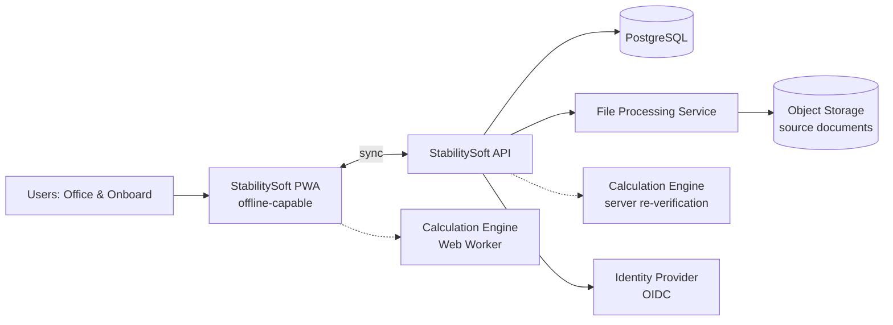

# Software Requirements Specification (SRS)

**StabilitySoft — Vessel Stability Platform**

| Item | Value |
|---|---|
| Document ID | SS-SRS-001 |
| Version | 0.1 (Draft) |
| Standard | Structured per IEEE 830-1998 / ISO/IEC/IEEE 29148:2018 |
| Status | For review |
| Related documents | SS-PRD-001 (PRD), SS-ARCH-001 (Architecture), SS-UX-001 (UI/UX), SS-CALC-001 (Calculation Methods, Appendix A) |

---

## Table of Contents

1. Introduction
2. Overall Description
3. Specific Requirements
   - 3.1 External Interface Requirements
   - 3.2 Functional Requirements
   - 3.3 Performance Requirements
   - 3.4 Logical Database Requirements
   - 3.5 Design Constraints
   - 3.6 Software System Attributes
4. Verification
5. Appendices (Traceability Matrix, Glossary)

---

## 1. Introduction

### 1.1 Purpose
This SRS defines the functional and non-functional requirements of StabilitySoft Phase 1 (Intact Stability). It also defines the architectural requirements that keep future modules possible. It is intended for developers, testers, naval architects, product owners and classification society reviewers.

### 1.2 Scope
StabilitySoft is a vessel stability calculation platform, delivered first as an offline-capable Progressive Web Application (PWA). It:
- maintains **vessel-specific databases** (particulars, lightship, hydrostatics, KN curves, tanks, windage, openings);
- **imports** engineering data from Excel, CSV, PDF and Word with mandatory human verification;
- manages **unlimited load cases** per vessel;
- calculates **intact stability** (displacement, drafts, trim, heel, KG, GM, FSC, GZ curve);
- checks the **IMO IS Code 2008** general criteria and the **Weather Criterion** automatically;
- produces **PDF and Excel reports**;
- keeps a complete **audit trail** of data and calculations.

Out of scope for Phase 1: damage stability, grain, timber deck cargo, towing, MODU, passenger criteria, longitudinal strength, and hull 3D modelling. The architecture must allow these to be added (see §3.5.4).

### 1.3 Definitions, acronyms, abbreviations

| Term | Definition |
|---|---|
| AP / FP | Aft / Forward Perpendicular |
| AVS | Angle of Vanishing Stability |
| Dataset | A versioned set of vessel engineering data (e.g. a hydrostatic table) |
| FSC / FSM | Free Surface Correction (m) / Free Surface Moment (t·m) |
| GM / GM_fluid | Metacentric height / metacentric height corrected for free surface |
| GZ | Righting lever |
| IS Code | IMO International Code on Intact Stability, 2008 |
| KN | Cross-curve value: righting lever with G assumed at keel |
| Load case | A loading condition (weights + tanks + environment) of a vessel |
| LCB, LCF, LCG | Longitudinal centre of buoyancy / flotation / gravity |
| MTC | Moment to change trim 1 cm |
| PWA | Progressive Web Application |
| TPC | Tonnes per cm immersion |
| Verification | The human act of confirming imported/entered data is correct |
| Approval | A second authorised person activating verified data for calculations |

(Full glossary in Appendix 5.2.)

### 1.4 References
1. IMO Res. MSC.267(85), *International Code on Intact Stability, 2008*, as amended.
2. IMO MSC.1/Circ.1229, *Guidelines for the Approval of Stability Instruments*.
3. IACS Unified Requirement L5, *Computer Software for Onboard Stability Calculations*.
4. IEEE 830-1998 / ISO/IEC/IEEE 29148:2018.
5. WCAG 2.2 AA.
6. SS-CALC-001, *Appendix A — Calculation Methods* (normative for all calculations).

### 1.5 Overview
Section 2 describes the product context. Section 3 lists the uniquely numbered, testable requirements. Section 4 explains how they are verified.

### 1.6 Requirement conventions
- **ID format:** `<AREA>-<NNN>`, e.g. `TNK-004`.
- **Priority:** **M** = Must (Phase 1), **S** = Should (Phase 1 if time allows), **F** = Future (architecture must allow).
- "Shall" = mandatory. "Should" = recommended.

---

## 2. Overall Description

### 2.1 Product perspective
StabilitySoft is a new, self-contained product that replaces vessel-specific Excel workbooks. It consists of:
- a **PWA client** (runs in Chromium, Edge, Safari and Firefox browsers; installable; offline);
- a **cloud/server back end** (API, PostgreSQL database, file-processing service);
- a **calculation engine** shared by client and server (identical code, identical results).

### 2.2 Product functions (summary)
1. Vessel database management
2. Data import & verification
3. Tank & solid weight management
4. Load case management
5. Intact stability calculation
6. Criteria evaluation
7. Visualisation
8. Reporting
9. User, role & audit management
10. Offline operation & synchronisation

### 2.3 User classes and characteristics

| User class | Description | Technical skill | Typical location |
|---|---|---|---|
| Fleet Naval Architect | Creates vessel databases, verifies imported data, approves datasets, maintains criteria | High (naval architecture) | Office |
| Master / Chief Officer | Creates load cases, checks stability before departure, prints reports | Medium (stability theory); low IT | Onboard, often offline |
| Superintendent / Ship Manager | Reviews conditions and compliance across the fleet | Medium | Office |
| Auditor / Class Surveyor | Read-only access to calculations, audit logs, reports | High | Office / onboard |
| System Administrator | Users, roles, organisation settings | IT | Office |

### 2.4 Operating environment
- **Client:** current versions of Chrome, Edge (Windows/macOS/Linux). Safari 17+ and Firefox are supported but not offline-primary. Minimum screen 1366×768. Designed for 1920×1080.
- **Onboard:** intermittent or no internet; satellite bandwidth possibly < 256 kbit/s; shared bridge/ship-office PCs.
- **Server:** Linux containers (Docker/Kubernetes) on any major cloud or on premises.

### 2.5 Design and implementation constraints
- TypeScript for client, API and engine.
- PostgreSQL as the system of record.
- Calculation methods only as defined in SS-CALC-001.
- All engineering data must be versioned and auditable. Calculations must be reproducible from stored inputs.
- No imported data may be used for calculation until verified (and approved, if the organisation enables four-eyes approval).

### 2.6 User documentation
Online help (context-sensitive), a User Manual (PDF), a Data Preparation Guide (how to prepare stability booklet data for import), and an Administrator Guide.

### 2.7 Assumptions and dependencies
- Vessel hydrostatic data, KN curves and tank tables are available from the approved Trim & Stability Booklet or the yard's data.
- Phase 1 calculations rely on **tabulated** hydrostatics/KN (no 3D hull model).
- Organisations provide an OIDC identity provider or use the built-in one.

---

## 3. Specific Requirements

### 3.1 External interface requirements

#### 3.1.1 User interfaces
| ID | Requirement | Pri |
|---|---|---|
| UI-001 | The system shall provide a left navigation panel with: Dashboard, Vessel Database, Hydrostatics, Tanks, Solid Loads, Load Cases, Stability, Criteria, Reports, Settings. | M |
| UI-002 | The system shall provide Dark and Light themes, switchable at runtime, defaulting to the OS preference. A "Night Bridge" (red-tinted, low-luminance) variant should be provided. | M / S |
| UI-003 | The layout shall be responsive for desktop resolutions from 1366×768 to 3840×2160. Tablet layout (≥1024 px) is S. | M |
| UI-004 | Every numeric field shall display its unit and enforce valid ranges. | M |
| UI-005 | Every calculated value shall offer a "trace" view showing its formula, inputs and data sources. | M |
| UI-006 | A persistent status bar shall show: active vessel, active load case, online/offline state, sync state, data approval state. | M |
| UI-007 | The UI shall meet WCAG 2.2 AA contrast and keyboard-operability requirements. | M |
| UI-008 | Pass/Fail shall never be conveyed by colour alone (icon + text required). | M |

#### 3.1.2 Hardware interfaces
| ID | Requirement | Pri |
|---|---|---|
| HW-001 | No special hardware is required. Printing via the OS printer dialog. | M |
| HW-002 | Future: tank-gauging system interface (OPC-UA / Modbus / NMEA) via the desktop app. | F |

#### 3.1.3 Software interfaces
| ID | Requirement | Pri |
|---|---|---|
| SW-001 | REST/JSON API (OpenAPI 3.1) for all client operations. | M |
| SW-002 | OIDC/OAuth 2.1 identity provider integration (Entra ID, Okta, Keycloak, Google). | M |
| SW-003 | Object storage (S3-compatible) for uploaded source documents and generated reports. | M |
| SW-004 | Optional AI extraction provider for document table extraction (configurable, can be disabled per organisation). | S |
| SW-005 | Future: Classification society data exchange (e.g. class approval submission packages). | F |

#### 3.1.4 Communication interfaces
| ID | Requirement | Pri |
|---|---|---|
| COM-001 | All network traffic shall use TLS 1.2+ (TLS 1.3 preferred). | M |
| COM-002 | Sync shall be resumable and tolerate links of 64 kbit/s and high latency (≥ 1.5 s RTT). | M |
| COM-003 | Sync payloads shall be compressed (gzip/brotli) and delta-based. | M |

### 3.2 Functional requirements

#### 3.2.1 Vessel Database (VDB)
| ID | Requirement | Pri |
|---|---|---|
| VDB-001 | The system shall allow creating an unlimited number of vessels per organisation. | M |
| VDB-002 | Each vessel shall store General Particulars: Ship Name, IMO Number, Call Sign, Flag, Ship Type, L_OA, L_BP, Breadth (moulded), Depth (moulded), Design Draft, Summer/Tropical/Winter/Fresh draft limits, reference water density, keel thickness, draft-mark positions, bilge type, bilge keel area A_k, source coordinate convention. | M |
| VDB-003 | IMO Number shall be validated with the IMO check-digit algorithm and be unique within the organisation. | M |
| VDB-004 | The system shall store Lightship (weight, LCG, TCG, VCG) as versioned vessel master data with source reference (e.g. inclining experiment report, date). | M |
| VDB-005 | Vessel data shall be organised into **Datasets** (Particulars, Lightship, Hydrostatics, KN, Tank Calibration, Windage, Openings, Deck-edge/Flooding-angle tables, Criteria Set). Each dataset has its own version and status: `DRAFT → VERIFIED → ACTIVE → SUPERSEDED / ARCHIVED`. | M |
| VDB-006 | Only one dataset version per (vessel, dataset type [, tank]) may be ACTIVE at any time. | M |
| VDB-007 | Activating a new dataset version shall not alter stored calculation runs. Existing load cases shall show "Data updated — recalculate" until recalculated. | M |
| VDB-008 | Vessels shall be exportable/importable as a signed package (`.ssvessel`, JSON + checksums) for transfer between organisations or to offline installations. | S |
| VDB-009 | Vessels can be archived (read-only) but never hard-deleted while calculation runs or reports reference them. | M |

#### 3.2.2 Data Source Mode (DSM): import vs manual entry
| ID | Requirement | Pri |
|---|---|---|
| DSM-001 | For **each dataset individually** (e.g. hydrostatic table, KN table, each tank's sounding table, lightship), the user shall choose a source mode: **IMPORTED** or **MANUAL**. | M |
| DSM-002 | When a dataset's source mode is IMPORTED, free manual entry into that dataset shall be disabled. Values may only be changed in the Import Verification step as **logged corrections** (old value, new value, reason, source page/cell reference, user, timestamp). | M |
| DSM-003 | When source mode is MANUAL, data shall be entered in a validated grid (paste from clipboard allowed, logged as manual entry). | M |
| DSM-004 | Changing the source mode of a dataset shall create a new DRAFT version. It shall never modify an ACTIVE version. | M |
| DSM-005 | The source mode and source document of every dataset shall be displayed in the dataset header and in reports. | M |

#### 3.2.3 Hydrostatics (HYD)
| ID | Requirement | Pri |
|---|---|---|
| HYD-001 | Store complete hydrostatic tables with columns: Draft, Trim (optional; 0 for even keel), Displacement, Volume, TPC, MTC, LCB, LCF, KB, BM_T, KM_T, BM_L/KM_L (optional), Waterplane Area, C_B, C_P, C_W, C_M (optional), L_WL, Wetted surface (optional). | M |
| HYD-002 | Store reference density and the longitudinal reference/sign convention for each table. | M |
| HYD-003 | Validate: strictly increasing draft; displacement increasing with draft; KM ≈ KB + BM within tolerance (warning); TPC ≈ A_WP·ρ/100 within tolerance (warning); Δ ≈ ∇·ρ (warning). | M |
| HYD-004 | Support multiple trim values (trimmed hydrostatics) for free-trim calculation. | S |
| HYD-005 | Plot hydrostatic curves (any column vs draft), with selectable columns. | M |

#### 3.2.4 Cross Curves / KN (KN)
| ID | Requirement | Pri |
|---|---|---|
| KN-001 | Store KN values as a matrix: displacement (or volume) × heel angle [× trim], with declared basis (displacement at ρ_ref or volume) and type (fixed-trim / free-trim). | M |
| KN-002 | Support any heel angle set (e.g. 0, 5, 10, 12, 15, 20, 30, 40, 50, 60, 70, 80, 90°). | M |
| KN-003 | Validate: KN(0°) = 0 (±0.001 m); monotonic displacement axis; no gaps. | M |
| KN-004 | Plot KN curves (family of curves) for visual verification against the booklet. | M |

#### 3.2.5 Tanks (TNK)
| ID | Requirement | Pri |
|---|---|---|
| TNK-001 | For each tank, store: Name, Tank Group/Type (Ballast, FO, DO, LO, FW, Slop, Cargo, Misc), Side (P/S/C), default liquid density, 100% capacity (m³), consumable flag, FSM group, FSM exemption flag, colour, frame range. | M |
| TNK-002 | Store a calibration table per tank: Sounding (and/or ullage), [Trim], [Heel], Volume, LCG, TCG, VCG, FSM or transverse inertia i_T. | M |
| TNK-003 | Tank status input methods: **Filled (100%)**, **Percentage**, **Volume (m³)**, **Weight (t)**, **Sounding (m)**, optionally **Ullage (m)**. | M |
| TNK-004 | The system shall convert any input to Volume, Weight, % fill, LCG/TCG/VCG, moments and FSM, per SS-CALC-001 §A.4. All derived values are displayed immediately. | M |
| TNK-005 | Liquid density shall be editable per tank per load case (default from tank). | M |
| TNK-006 | Over-capacity (>100%) shall block; > 98% (configurable) shall warn. | M |
| TNK-007 | Tank plan diagram: profile and plan view showing tank boundaries coloured by fill %. | M |

#### 3.2.6 Solid weights & Lightship (WGT)
| ID | Requirement | Pri |
|---|---|---|
| WGT-001 | Users shall add **Fixed** weights (vessel master data; e.g. permanent ballast, spares) and **Variable** weights (per load case; e.g. crew & effects, provisions, deck cargo). | M |
| WGT-002 | Each weight: Description, Category, Weight (t), LCG, TCG, VCG, optional windage area & centroid (for deck cargo), optional FSM. | M |
| WGT-003 | Weight libraries: reusable weight templates (e.g. "Crew & effects 20 pers."). | S |
| WGT-004 | Lightship shall be read from the ACTIVE lightship dataset and cannot be edited inside a load case. | M |

#### 3.2.7 Windage, openings and limits (ENV)
| ID | Requirement | Pri |
|---|---|---|
| ENV-001 | Store windage table: draft → projected lateral area A, centroid height above base h_A, [underwater lateral centroid h_U]. | M |
| ENV-002 | Store down-flooding openings: name, x, y, z, type (weathertight/unprotected), side. | M |
| ENV-003 | Store optionally an approved flooding-angle table θ_f vs displacement and deck-edge immersion angle table. Choose the source per SS-CALC-001 §A.7.3. | M |
| ENV-004 | Store operational limits (max draft per zone, min fwd draft, max trim, max heel, air draft). | M |

#### 3.2.8 Load Case Management (LC)
| ID | Requirement | Pri |
|---|---|---|
| LC-001 | Unlimited load cases per vessel, each with: Name, Type (Departure, Arrival, Ballast, Harbour, Heavy Weather, Special Cargo, Custom), Voyage reference, Date, Sea water density, Load-line zone, Free-surface method, Criteria set(s), Notes. | M |
| LC-002 | Load cases shall be **saved within the vessel database** and reference the dataset versions used. | M |
| LC-003 | **Duplicate** a load case (all items copied, new name, new ID, "duplicated from" link). | M |
| LC-004 | **Compare** 2–4 load cases side by side: key results, criteria, tank/weight differences highlighted, GZ curves overlaid. | M |
| LC-005 | **Export** a load case as Excel (.xlsx), PDF report, or portable JSON (.sslc). | M |
| LC-006 | **Archive** a load case (read-only, hidden from default lists, restorable). | M |
| LC-007 | **Lock** a load case after report issue. Edits then require "Revise", which creates revision N+1. | M |
| LC-008 | Templates: create a load case from a template (e.g. standard departure). | S |
| LC-009 | Arrival condition generator: from a departure, apply consumption % to consumable tanks. | S |

#### 3.2.9 Calculation Engine (CALC)
| ID | Requirement | Pri |
|---|---|---|
| CALC-001 | Calculate displacement, LCG, TCG, KG per §A.3. | M |
| CALC-002 | Calculate draft by hydrostatic interpolation, trim, draft AP/FP/MS/marks, mean draft per §A.5. | M |
| CALC-003 | Calculate KM, GM_solid, FSC, GM_fluid, KG_fluid per §A.5.3. | M |
| CALC-004 | Calculate static heel per §A.5.4. | M |
| CALC-005 | Calculate the GZ curve per §A.7 over 0–90° (default) or a user range. | M |
| CALC-006 | Calculate free surface correction using the selected method per §A.6. | M |
| CALC-007 | Down-flooding assessment: θ_f and governing opening per §A.7.3. | M |
| CALC-008 | Wind heeling levers l_w1, l_w2 per §A.9.1. | M |
| CALC-009 | Weather criterion per §A.9 including all intermediate parameters. | M |
| CALC-010 | Results shall update in real time (≤ 300 ms after input change, see PERF-002) while editing a load case. | M |
| CALC-011 | No extrapolation beyond table ranges. Out-of-range inputs produce blocking errors naming the table and limits. | M |
| CALC-012 | Each "official" calculation (on save, report or compare) shall create an immutable **CalculationRun** containing: input snapshot, dataset version IDs and hashes, engine version, settings (interpolation, FSM method), results, warnings and a SHA-256 hash of all of these. | M |
| CALC-013 | The server shall re-run the engine on sync and flag any mismatch with the client result (integrity check). | M |
| CALC-014 | Engine plug-in interface for additional heeling moments (turning, crowding, ice, crane, towing, dynamic wind, custom). | F (interface M) |

#### 3.2.10 GZ Curve Module (GZ)
| ID | Requirement | Pri |
|---|---|---|
| GZ-001 | Display a GZ curve chart: GZ vs heel, with GM tangent line (GM at 57.3°), θ_f marker, angle of max GZ, AVS, equilibrium heel and, when relevant, wind heeling levers and Weather Criterion areas a/b shaded. | M |
| GZ-002 | Display a GZ table with columns: Heel angle, KN, KG_fluid·sin φ, TCG·cos φ, GZ. | M |
| GZ-003 | Angle range: 0–90° default; user-defined min/max/step. | M |
| GZ-004 | Table and chart update in real time with load-case edits. | M |
| GZ-005 | Overlay up to 4 load cases for comparison. | M |
| GZ-006 | Export chart (PNG/SVG) and table (CSV/Excel). | M |

#### 3.2.11 Stability Criteria Engine (CRIT)
| ID | Requirement | Pri |
|---|---|---|
| CRIT-001 | Criteria are defined as **data** (rule definitions with parameters), not hard-coded logic. Each criterion references a calculator function from the engine's registry. | M |
| CRIT-002 | Built-in, read-only criteria sets: **IS Code 2008 — General (Part A §2.2)** and **IS Code 2008 — Weather Criterion (Part A §2.3)**. | M |
| CRIT-003 | Users select which criteria sets apply per load case (default per vessel). | M |
| CRIT-004 | For each criterion: Required value, Actual value, Pass/Fail, Margin (absolute and %), and a plain-language **failure explanation** per §A.10. | M |
| CRIT-005 | Overall load-case status: PASS only if all applicable criteria pass. Otherwise FAIL, listing the failing criteria. | M |
| CRIT-006 | Operational checks (draft, trim, heel limits) are shown separately as "Operational limits". | M |
| CRIT-007 | User-defined criteria: users with the Naval Architect role can clone a criteria set and adjust parameters, or compose new criteria from engine primitives (area between angles, GZ at angle, angle of max GZ, GM, heel under moment). These are clearly labelled "Non-statutory". | F (data model M) |
| CRIT-008 | Criteria-set versions are immutable once used in a calculation run. | M |

#### 3.2.12 Import Module (IMP)
| ID | Requirement | Pri |
|---|---|---|
| IMP-001 | Accept uploads: .xlsx, .xls (S), .csv, .pdf (text and scanned), .docx. Maximum 100 MB per file. | M |
| IMP-002 | Store the original file unchanged with its SHA-256 hash. | M |
| IMP-003 | Pipeline: **Extract → Detect tables → Classify (suggest dataset type) → Map columns → Present editable tables → Validate → Verify (user) → Save as DRAFT/VERIFIED dataset version**. | M |
| IMP-004 | For PDFs, show the source page image side by side with the extracted table. Selecting a cell highlights its source region. | M |
| IMP-005 | Column mapping: user maps detected columns to target fields and units (e.g. "LCG (m fwd of midship)" → LCG, convention MIDSHIP_FWD_POS). Mappings can be saved as reusable templates per shipyard/booklet format. | M |
| IMP-006 | Low-confidence extracted cells (OCR/AI confidence below threshold) shall be highlighted and must be explicitly confirmed. | M |
| IMP-007 | **No imported data shall be trusted automatically.** Saving requires the user to tick "I have verified these values against the source document". This is recorded with user and timestamp. | M |
| IMP-008 | AI-assisted extraction may be enabled per organisation. AI output is treated exactly like any other extraction: it is unverified until a human verifies it. | S |
| IMP-009 | Engineering validation rules (HYD-003, KN-003, tank monotonicity, etc.) run before verification is allowed. Errors block. Warnings require acknowledgement. | M |
| IMP-010 | Offline: .xlsx/.csv import works fully offline. PDF/Word imports are queued and processed when online. | M |
| IMP-011 | A partial import is allowed. A user may import hydrostatics while entering lightship manually (per DSM-001). | M |

#### 3.2.13 Visualisation (VIS)
| ID | Requirement | Pri |
|---|---|---|
| VIS-001 | GZ curve (see GZ-001). | M |
| VIS-002 | Weight distribution diagram: longitudinal bar/profile showing weights along ship length, with LCG and LCB markers. | M |
| VIS-003 | Tank filling diagram: profile + plan schematic, colour by fill %, labels with %/t on hover. | M |
| VIS-004 | Hydrostatic curves graph. | M |
| VIS-005 | Stability summary dashboard: key figures, criteria status, drafts graphic (ship profile with draft marks and trim). | M |
| VIS-006 | Charts shall use engineering style: grid, labelled axes with units, no decorative 3D, printable in monochrome. | M |

#### 3.2.14 Reporting (RPT)
| ID | Requirement | Pri |
|---|---|---|
| RPT-001 | Generate a report for a load case containing: cover (vessel, condition, date, revision, prepared/checked by), Vessel Information, Load Condition summary, Drafts (AP/FP/MS/marks), Trim, Heel, Tank Status table, Weight Summary, Hydrostatic particulars at condition, GZ table & curve, Criteria results with margins, Operational checks, Warnings, and a Calculation trace appendix (engine version, dataset versions, run hash). | M |
| RPT-002 | Export as **PDF** (A4 / Letter, portrait with landscape inserts) and **Excel** (.xlsx, one sheet per section, values not formulas). | M |
| RPT-003 | Reports shall be generated offline on the client and be identical to server-generated versions. | M |
| RPT-004 | Issued reports are immutable and stored with the run hash. A QR code / ID on each page allows verification of authenticity. | M (QR: S) |
| RPT-005 | Report templates may be branded per organisation (logo, colours, header/footer). | S |
| RPT-006 | Until the system is class-approved, every page shall carry "Not an approved stability instrument — for planning purposes only" (configurable only by a system-level flag after approval). | M |

#### 3.2.15 Users, roles, security & audit (SEC)
| ID | Requirement | Pri |
|---|---|---|
| SEC-001 | Authentication via OIDC (SSO) or built-in email + password + TOTP MFA. | M |
| SEC-002 | Roles: **Org Admin, Naval Architect, Master/Officer, Superintendent (read + comment), Auditor (read-only + audit), Viewer**. Permissions are scoped per vessel. | M |
| SEC-003 | Dataset activation requires the Naval Architect role. Optional **four-eyes rule**: the verifier cannot be the approver. | M |
| SEC-004 | Audit log of every create/update/delete/verify/approve/activate/calculate/report/login event, with user, device, timestamp (UTC), before/after values. Append-only. Tamper-evident through a hash chain. | M |
| SEC-005 | Offline access: a cached session valid for a configurable offline grace period (default 30 days), protected by a device PIN. Revocation applies at the next sync. | M |
| SEC-006 | Data at rest: server DB and object storage encrypted. Client IndexedDB data encrypted with a key derived from the user session/PIN (WebCrypto). | M |
| SEC-007 | Multi-tenant isolation: every row scoped by organisation and enforced with PostgreSQL Row-Level Security. | M |

#### 3.2.16 Offline & Sync (OFF)
| ID | Requirement | Pri |
|---|---|---|
| OFF-001 | After first login and vessel download, all Phase 1 features except PDF/Word extraction and SSO login shall work offline. | M |
| OFF-002 | The application shell and assets are cached by a Service Worker. Updates are applied on the next launch after user confirmation. | M |
| OFF-003 | Vessel master datasets are **read-only replicas** onboard unless the user holds the Naval Architect role. | M |
| OFF-004 | Load cases are editable offline. Changes are queued (outbox) and synced when online. | M |
| OFF-005 | Conflicts (the same load case edited on two devices) are never auto-merged silently. Both versions are kept and the user resolves the conflict. | M |
| OFF-006 | The UI shall show sync status, pending changes count and last successful sync time. | M |

### 3.3 Performance requirements
| ID | Requirement |
|---|---|
| PERF-001 | Cold start of installed PWA ≤ 3 s on a mid-range PC (2020+, 8 GB RAM). |
| PERF-002 | Full intact stability recalculation (≤ 200 tanks, ≤ 500 weights, GZ 0–90° @1°, both criteria sets) ≤ 150 ms in a Web Worker (target), ≤ 300 ms (limit). |
| PERF-003 | UI interactions (navigation, grid edit) respond ≤ 100 ms. |
| PERF-004 | Import extraction of a 50-page PDF ≤ 2 min (server). |
| PERF-005 | PDF report generation (20 pages) ≤ 5 s client side. |
| PERF-006 | Support ≥ 1,000 vessels and ≥ 100,000 load cases per organisation without degradation of list views (paginated, < 500 ms). |

### 3.4 Logical database requirements
- Entities, relationships and indexes are defined in SS-ARCH-001 §5.
- All engineering data rows are immutable once their dataset version is VERIFIED. Changes create new versions.
- UUIDv7 primary keys (client-generatable for offline creation, time-sortable).
- Retention: calculation runs, issued reports and audit logs are kept ≥ 10 years (configurable). Hard deletes are prohibited for referenced records.

### 3.5 Design constraints

#### 3.5.1 Standards compliance
IS Code 2008 (Phase 1 criteria), MSC.1/Circ.1229 and IACS UR L5 (design aligned for future approval), WCAG 2.2 AA, OWASP ASVS Level 2.

#### 3.5.2 Calculation integrity
- The engine is a pure, deterministic library with no I/O and no randomness. The same inputs always give bit-identical outputs on client and server (same JS engine semantics). Floating-point summation uses ordered (Kahan) summation to reduce platform variance.
- Users cannot modify formulas.

#### 3.5.3 Portability
The client must be packageable as a desktop app (Tauri) and mobile app (Capacitor) without rewriting UI or engine code. Platform services (storage, file system, printing) are accessed through adapter interfaces.

#### 3.5.4 Extensibility (future modules)
| ID | Requirement |
|---|---|
| EXT-001 | Stability modules (Intact, Damage, Grain, Timber, Towing, MODU, Passenger) are registered through a module interface: `{ id, datasetsRequired, loadCaseExtensions, calculators, criteriaFunctions, uiRoutes, reportSections }`. |
| EXT-002 | External heeling moments are implemented as `HeelingMoment` providers returning a heeling lever as a function of heel angle, l(φ). Phase 1 provides `WindHeeling`. Future providers include Turning, PassengerCrowding, IceAccretion (as weight + windage modifier), Crane, Towing, DynamicWind and CustomTable. |
| EXT-003 | Criteria functions are registered in a registry keyed by ID. Criteria sets reference them with parameters, so new criteria need no schema change. |
| EXT-004 | The database schema uses typed tables for core engineering data and a versioned `jsonb` extension column (`ext`) for module-specific data. This avoids migrations for experimental modules. |

### 3.6 Software system attributes
| Attribute | Requirement |
|---|---|
| Reliability | Server availability 99.5% (Phase 1), 99.9% (Phase 3+). The client never loses saved data (writes are transactional in IndexedDB). |
| Availability onboard | 100% for offline-capable features (no server dependency). |
| Security | See SEC-*. Annual penetration test. OWASP ASVS L2. |
| Maintainability | ≥ 90% unit test coverage on the engine (100% on criteria functions). ≥ 70% overall. Strict TypeScript. Lint-clean. |
| Traceability | Every result traceable to formula, inputs, dataset versions and engine version (CALC-012, UI-005). |
| Auditability | SEC-004. Reproduce any historical run byte-for-byte with the stored engine version. |
| Usability | A new Chief Officer can complete a departure condition with ≤ 30 min of training (validated by usability test). |
| Localisation | English at launch. Architecture i18n-ready (all strings externalised). Units fixed SI (Phase 1). |

---

## 4. Verification

| Method | Applied to |
|---|---|
| **Test (T)** | All CALC, CRIT, GZ, TNK conversion requirements, via automated unit, property and benchmark tests (SS-CALC-001 §A.13). |
| **Demonstration (D)** | UI, import workflow, offline operation, reports. |
| **Inspection (I)** | Audit log content, report layout, documentation. |
| **Analysis (A)** | Performance, security. |

Acceptance for Phase 1 requires:
1. All **M** requirements verified.
2. Benchmark results within tolerance for 3 vessels × all booklet conditions.
3. Usability test with ≥ 5 deck officers: task success ≥ 90%.
4. Offline test: 7-day disconnected operation with subsequent successful sync.

---

## 5. Appendices

### 5.1 Requirements traceability matrix (excerpt)

| Business problem (PRD) | Requirements | Verification |
|---|---|---|
| Human input errors | UI-004, TNK-004, TNK-006, IMP-009, CALC-011 | T, D |
| Formula modification errors | §3.5.2, CALC-012, CALC-013 | T, I |
| Version control problems | VDB-005..007, DSM-004, CRIT-008, LC-007 | T, D |
| Managing multiple load cases | LC-001..009 | D |
| Managing vessel databases | VDB-*, IMP-* | D |
| No automated criteria checks | CRIT-*, CALC-009 | T |
| Data transfer errors | IMP-002..007, DSM-002 | D, I |

### 5.2 Glossary
See §1.3, plus:
- **Calculation Run:** immutable record of one calculation with all inputs and outputs.
- **Criteria Set:** versioned collection of criteria with parameters.
- **Four-eyes rule:** one person verifies, a different person approves.
- **Outbox:** local queue of changes waiting to be synced.
- **PCHIP:** Piecewise Cubic Hermite Interpolating Polynomial (shape-preserving).
- **Service Worker:** browser background script enabling offline operation.
