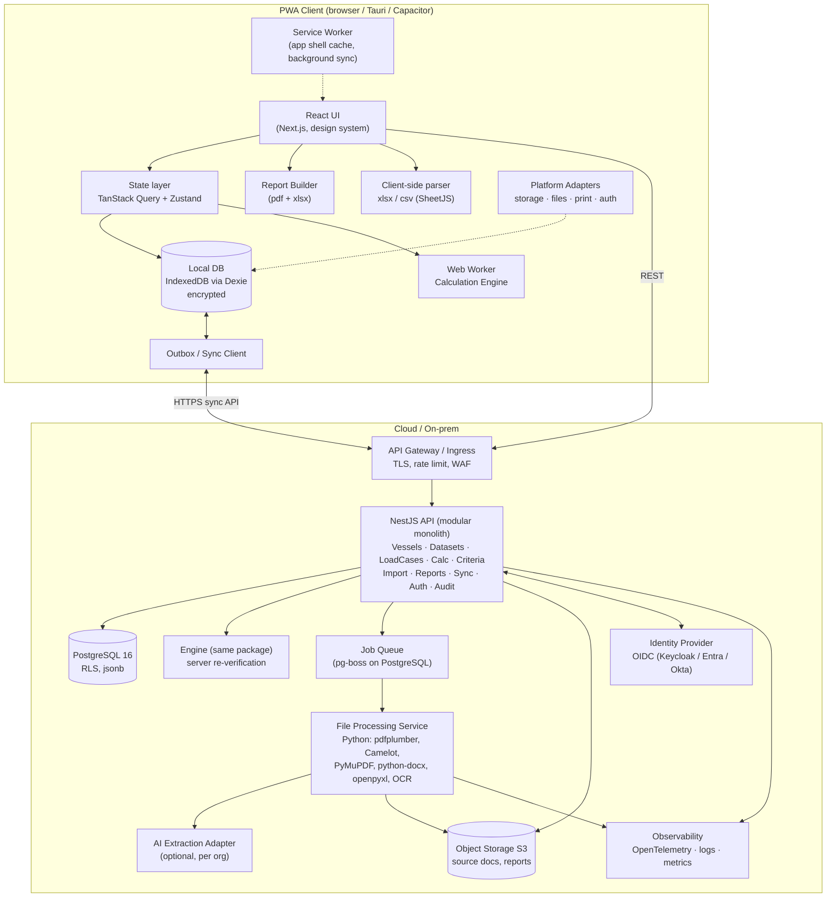
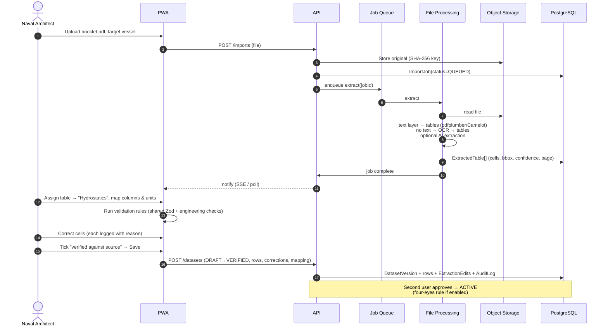
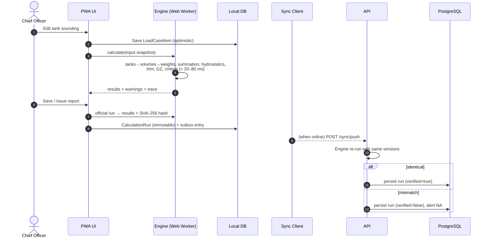
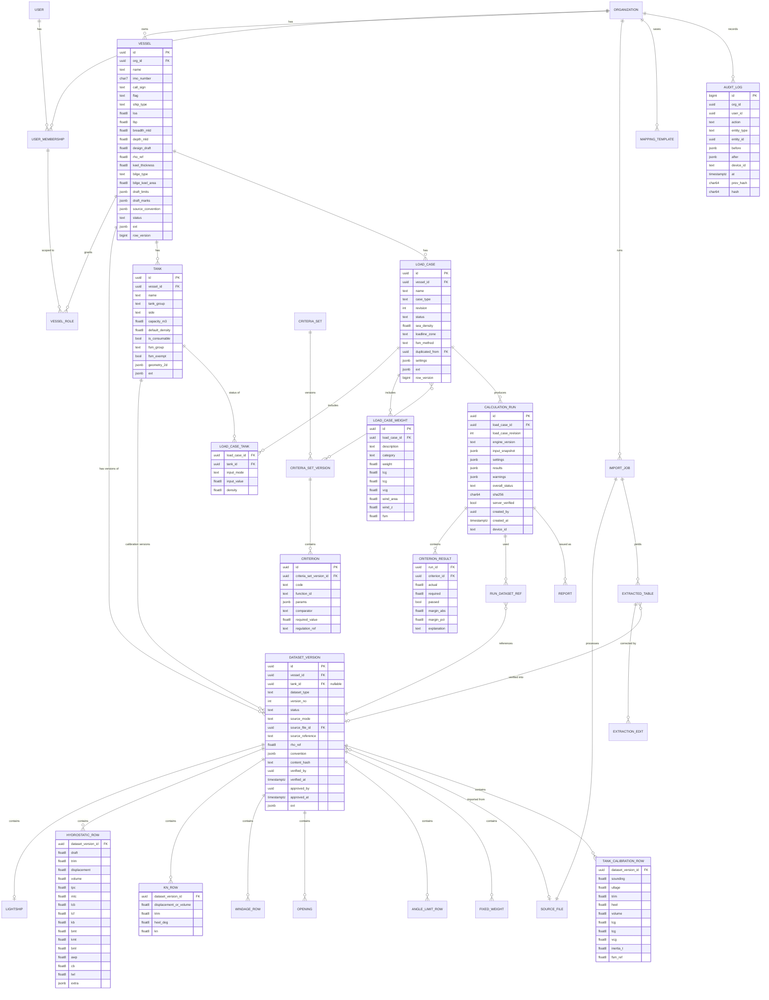

# System Architecture Document

**StabilitySoft — Vessel Stability Platform**

| Item | Value |
|---|---|
| Document ID | SS-ARCH-001 |
| Version | 0.1 (Draft) |
| Owner | Technical Lead |
| Related | SS-SRS-001, SS-CALC-001, SS-TECH-001 |

---

## 1. Architectural drivers

| Driver | Architectural response |
|---|---|
| Calculation accuracy & identical results everywhere | One **pure TypeScript engine package**, used in browser (Web Worker), server (Node) and future desktop/mobile apps |
| Offline onboard operation | **Local-first** client: IndexedDB replica + outbox sync + Service Worker |
| Traceability & auditability | Immutable versioned datasets, immutable calculation runs with hashes, hash-chained audit log |
| No unverified data in calculations | Dataset state machine enforced in API, DB constraints and engine input builder |
| Future modules without rewrites | Module registry, heeling-moment providers, data-driven criteria, `jsonb` extension columns |
| PWA → desktop/mobile | Platform adapter layer. Tauri (desktop) and Capacitor (mobile) shells reuse the web build |
| Multi-tenant SaaS & on-prem | Containerised services, PostgreSQL row-level security, S3-compatible storage |

## 2. Architectural style

- **Modular monolith API** (NestJS) with strict internal module boundaries. This keeps Phase 1 simple and lets modules be split into services later, if load requires it.
- **Separate File-Processing Service** (Python), because the best PDF/OCR table-extraction libraries are in Python and the workload is asynchronous and CPU-heavy.
- **Local-first client** (Next.js static export + React) whose primary data source is the local database. The server is the system of record and sync hub.
- **Monorepo** (pnpm + Turborepo) sharing types, validation schemas and the engine.

```
stabilitysoft/
├── apps/
│   ├── web/            Next.js PWA (UI, Service Worker, local DB, Web Worker host)
│   ├── api/            NestJS API (REST, sync, auth, Prisma)
│   ├── fileproc/       Python FastAPI + worker (extraction, OCR, table detection)
│   ├── desktop/        (Phase 4) Tauri shell
│   └── mobile/         (Phase 4) Capacitor shell
├── packages/
│   ├── engine/         Pure TS calculation engine (no I/O)
│   ├── engine-ref/     Python reference implementation (verification only)
│   ├── criteria/       Criteria definitions (IS Code 2008 sets as data)
│   ├── schemas/        Zod schemas = single source for validation & API types
│   ├── domain/         Domain types, units, sign-convention converters
│   ├── ui/             Design system (components, charts, tokens)
│   ├── report/         Report builder (PDF + XLSX), runs client & server
│   └── sync/           Sync protocol client/server shared logic
└── docs/
```

---

## 3. Component diagram



### 3.1 Component responsibilities

| Component | Responsibilities | Notes |
|---|---|---|
| React UI | Screens, grids, charts, forms, theming | No business calculations in UI code |
| State layer | Query caching, optimistic updates, UI state | Reads from local DB first |
| Local DB | Replica of permitted vessels, datasets, load cases, runs; outbox | Encrypted with WebCrypto (AES-GCM) |
| Web Worker engine | All stability calculations | Keeps UI at 60 fps during recalculation |
| Report Builder | PDF (pdf-lib / React-PDF) & XLSX (ExcelJS) | Same package server-side for identical output |
| Service Worker | Precache app shell, runtime caching, background sync trigger | Serwist (Workbox successor for Next.js) |
| NestJS API | AuthZ, validation, persistence, workflow (state machines), sync, audit | OpenAPI generated from Zod schemas |
| Engine (server) | Recompute every synced official run; mismatch → flag | Pinned engine version per run |
| Job Queue | Import jobs, report rendering, re-verification batches | pg-boss avoids extra infrastructure; Redis/BullMQ if needed later |
| File Processing | Extract text/tables, OCR, detect & classify tables, produce cell-level confidence & bounding boxes | Stateless workers, horizontally scalable |
| AI Extraction Adapter | Optional vision-LLM extraction for difficult scans | Output is treated as unverified, like any extraction |
| PostgreSQL | System of record | RLS for tenant isolation |
| Object storage | Original uploads (hash-addressed), issued reports | Versioning + object lock for issued reports |
| Identity Provider | SSO, MFA | Built-in Keycloak for customers without SSO |

---

## 4. Data flow

### 4.1 Import & verification flow



### 4.2 Load case calculation flow (offline-capable)



### 4.3 Calculation engine internal pipeline

```mermaid
flowchart LR
  A[Input Snapshot<br/>validated by Zod] --> B[Unit & convention<br/>normaliser]
  B --> C[Tank resolver<br/>input mode → V, W, CG, FSM]
  C --> D[Weight summation<br/>Kahan sum]
  D --> E[Hydrostatics solver<br/>density corr., even-keel / free-trim]
  E --> F[Initial stability<br/>KM, GM, FSC, heel]
  F --> G[GZ generator<br/>KN interp., PCHIP]
  G --> H[Heeling moment providers<br/>Wind · future: Turning, Crowd, Ice, Crane, Tow, Custom]
  H --> I[Criteria evaluator<br/>registry of criterion functions]
  I --> J[Explanation & sensitivity]
  J --> K[Result + Trace + Warnings + Hash]
```



Every stage emits **trace records** (`{id, formula, inputs[], output, source}`). These power the UI "trace" panel and the report appendix.

---

## 5. Database design (PostgreSQL)

### 5.1 Design principles
1. **Versioned datasets:** engineering data rows belong to a `dataset_version`. Rows in a VERIFIED or ACTIVE version are never updated. A change means a new version.
2. **Long (normalised) format for tables** (one row per table cell-row), enabling indexing, validation and precise provenance. Large matrices (KN) use one row per (displacement, angle, trim).
3. **UUIDv7 primary keys:** time-ordered, safe to generate offline on the client.
4. **Tenant isolation:** `org_id` on every tenant-scoped table, with RLS policies.
5. **Sync metadata:** `row_version` (bigint, incremented per change), `updated_at`, `deleted_at` (soft delete) on mutable tables.
6. **Extensibility:** `ext jsonb` on core tables for module-specific attributes, with a JSON-schema version key.
7. **Numeric types:** engineering values are stored as `double precision`, which matches the engine's IEEE-754 doubles exactly and avoids conversion drift. Money and quantities needing decimal exactness are not involved.

### 5.2 Entity-Relationship diagram



### 5.3 Table catalogue (key tables)

| Table | Purpose | Key constraints |
|---|---|---|
| `organization` | Tenant | — |
| `user`, `user_membership`, `vessel_role` | Identity & RBAC per vessel | unique (org_id, user_id); unique (membership_id, vessel_id, role) |
| `vessel` | General particulars | unique (org_id, imo_number) where not archived; IMO check digit `CHECK` via function |
| `dataset_version` | Header for every versioned dataset | `dataset_type` enum: PARTICULARS, LIGHTSHIP, HYDROSTATICS, KN, TANK_CALIBRATION, WINDAGE, OPENINGS, FLOODING_ANGLE, DECK_EDGE_ANGLE, FIXED_WEIGHTS, OPERATIONAL_LIMITS; `status` enum: DRAFT, VERIFIED, ACTIVE, SUPERSEDED, ARCHIVED; `source_mode` enum: IMPORTED, MANUAL |
| `lightship` | Lightship W, LCG, TCG, VCG, source (inclining date/report) | 1 row per dataset_version |
| `hydrostatic_row` | Hydrostatic table rows | unique (dataset_version_id, trim, draft); CHECK draft > 0 |
| `kn_row` | KN matrix | unique (dataset_version_id, trim, displacement_or_volume, heel_deg); CHECK heel_deg between −90 and 180 |
| `tank` | Tank master | unique (vessel_id, name) |
| `tank_calibration_row` | Calibration per tank version | unique (dataset_version_id, trim, heel, sounding) |
| `windage_row` | draft → A, h_A, h_U | unique (dataset_version_id, draft) |
| `opening` | Down-flooding points | — |
| `angle_limit_row` | θ_f / deck edge angle tables | unique (dataset_version_id, kind, displacement) |
| `fixed_weight` | Vessel fixed weights | — |
| `load_case` | Load case header | unique (vessel_id, name, revision) |
| `load_case_tank` | Tank status | PK (load_case_id, tank_id); `input_mode` enum FILLED, PERCENT, VOLUME, WEIGHT, SOUNDING, ULLAGE |
| `load_case_weight` | Variable weights | — |
| `load_case_criteria_set` | M:N load case ↔ criteria set version | PK (load_case_id, criteria_set_version_id) |
| `calculation_run` | Immutable run | insert-only (trigger blocks UPDATE/DELETE except `server_verified`) |
| `run_dataset_ref` | Exact dataset versions used | PK (run_id, dataset_version_id) |
| `criterion_result` | Per-criterion result | PK (run_id, criterion_id) |
| `criteria_set`, `criteria_set_version`, `criterion` | Data-driven criteria | version immutable once referenced |
| `report` | Issued report metadata, object key, run_id, hash | insert-only |
| `source_file` | Uploaded original, sha256, mime, size, object key | unique (org_id, sha256) (de-duplication) |
| `import_job` | Import pipeline status | status enum QUEUED, PROCESSING, READY, FAILED, COMPLETED |
| `extracted_table` | Detected table: page, bbox, cells jsonb (value, bbox, confidence), classification | — |
| `extraction_edit` | Logged correction: cell, old, new, reason, user, at | insert-only |
| `mapping_template` | Saved column mappings | unique (org_id, name) |
| `audit_log` | Hash-chained audit | insert-only; partitioned monthly |
| `sync_cursor` | Per device last-pulled position | PK (device_id) |

### 5.4 Relationships & integrity rules (enforced in DB where possible)

- A `dataset_version` with `status = ACTIVE` is unique per `(vessel_id, dataset_type, coalesce(tank_id, nil))`, via a **partial unique index**.
- Child rows of a non-DRAFT dataset version cannot be modified (trigger checks parent status).
- A `calculation_run` can only reference dataset versions that were ACTIVE or VERIFIED at creation (validated in API; recorded in `run_dataset_ref`).
- `load_case.status = LOCKED` prevents changes to its items (trigger).
- Deleting a vessel/tank/dataset referenced by any run is prohibited (`ON DELETE RESTRICT`). Archival is used instead.

### 5.5 Index strategy

| Index | Type | Reason |
|---|---|---|
| All FK columns | B-tree | Join performance, RESTRICT checks |
| `vessel (org_id, name)` | B-tree | Fleet list, search |
| `vessel (org_id, imo_number)` partial `WHERE status <> 'ARCHIVED'` | Unique B-tree | IMO uniqueness |
| `dataset_version (vessel_id, dataset_type, tank_id) WHERE status='ACTIVE'` | Partial unique | One active version rule + fast lookup of active data |
| `dataset_version (vessel_id, dataset_type, version_no DESC)` | B-tree | Version history |
| `hydrostatic_row (dataset_version_id, trim, draft)` | Unique B-tree | Ordered range scans for interpolation export |
| `kn_row (dataset_version_id, trim, displacement_or_volume, heel_deg)` | Unique B-tree | Matrix retrieval |
| `tank_calibration_row (dataset_version_id, trim, heel, sounding)` | Unique B-tree | Calibration retrieval |
| `load_case (vessel_id, status, updated_at DESC)` | B-tree | Load case list (non-archived first) |
| `load_case (org_id, updated_at, row_version)` | B-tree | **Sync pull** by cursor |
| `calculation_run (load_case_id, created_at DESC)` | B-tree | Latest run lookup |
| `calculation_run (sha256)` | Unique B-tree | Report authenticity verification |
| `calculation_run (results)` | GIN (`jsonb_path_ops`) | Ad hoc fleet analytics (e.g. all runs with GM < x) |
| `criterion_result (criterion_id, passed)` | B-tree | Fleet compliance dashboards |
| `audit_log (org_id, entity_type, entity_id, at)` | B-tree | Entity history |
| `audit_log (at)` | BRIN | Large append-only time-ordered table |
| `source_file (org_id, sha256)` | Unique B-tree | Duplicate upload detection |
| `vessel (name)` | GIN trigram (`pg_trgm`) | Fuzzy search by vessel name |

Partitioning: `audit_log` and `calculation_run` are range-partitioned by month once they exceed ~50M rows.

### 5.6 Row-Level Security (example)

```sql
ALTER TABLE vessel ENABLE ROW LEVEL SECURITY;
CREATE POLICY vessel_tenant ON vessel
  USING (org_id = current_setting('app.org_id')::uuid
         AND (current_setting('app.is_org_admin')::bool
              OR id IN (SELECT vessel_id FROM vessel_role
                        WHERE membership_id = current_setting('app.membership_id')::uuid)));
```

The API sets `app.org_id` / `app.membership_id` per transaction (Prisma `$transaction` + `SET LOCAL`).

### 5.7 Client-side (IndexedDB) schema
Mirrors server tables needed offline: `vessels`, `datasetVersions` (ACTIVE + referenced), table rows (stored as columnar typed arrays per dataset for speed), `tanks`, `loadCases`, `loadCaseTanks`, `loadCaseWeights`, `calculationRuns`, `criteriaSets`, `outbox`, `syncState`, `pendingImports`. Encrypted at field level for sensitive records.

---

## 6. API design

### 6.1 Conventions
- REST, JSON, OpenAPI 3.1 generated from Zod schemas (`packages/schemas`).
- Base path `/api/v1`. Resource IDs are UUIDv7.
- Auth: `Authorization: Bearer <access token>` (OIDC). Org context from token claims.
- Optimistic concurrency: `If-Match: <row_version>` on PUT/PATCH. A mismatch returns `409 Conflict` with the current entity.
- Idempotency: `Idempotency-Key` header on POST (required for sync and offline-created entities).
- Errors: RFC 9457 Problem Details, with engineering error codes (e.g. `OUT_OF_TABLE_RANGE`).
- Pagination: cursor-based (`?cursor=&limit=`).

### 6.2 Endpoints

**Vessels**
| Method | Path | Description |
|---|---|---|
| GET | `/vessels` | List (filter, search, cursor) |
| POST | `/vessels` | Create vessel |
| GET | `/vessels/{vesselId}` | Get particulars + active dataset summary |
| PATCH | `/vessels/{vesselId}` | Update particulars (creates PARTICULARS dataset version) |
| POST | `/vessels/{vesselId}/archive` | Archive |
| GET | `/vessels/{vesselId}/export` | Export `.ssvessel` package |
| POST | `/vessels/import-package` | Import `.ssvessel` |

**Datasets (generic for all dataset types)**
| Method | Path | Description |
|---|---|---|
| GET | `/vessels/{id}/datasets?type=HYDROSTATICS&status=ACTIVE` | List versions |
| POST | `/vessels/{id}/datasets` | Create DRAFT version `{type, sourceMode, tankId?, rows[], convention, rhoRef}` |
| GET | `/datasets/{dsId}` | Header + rows |
| PUT | `/datasets/{dsId}/rows` | Replace rows (DRAFT + MANUAL only) |
| POST | `/datasets/{dsId}/validate` | Run validation rules → errors/warnings |
| POST | `/datasets/{dsId}/verify` | DRAFT → VERIFIED (attestation required) |
| POST | `/datasets/{dsId}/approve` | VERIFIED → ACTIVE (supersedes previous) |
| POST | `/datasets/{dsId}/archive` | Archive |
| GET | `/datasets/{dsId}/diff/{otherDsId}` | Version comparison |

**Tanks**
| Method | Path | Description |
|---|---|---|
| GET/POST | `/vessels/{id}/tanks` | List / create |
| GET/PATCH | `/tanks/{tankId}` | Get / update master data |

**Load cases**
| Method | Path | Description |
|---|---|---|
| GET/POST | `/vessels/{id}/load-cases` | List / create (optional `templateId`) |
| GET/PATCH | `/load-cases/{lcId}` | Get (with items) / update header |
| PUT | `/load-cases/{lcId}/tanks` | Bulk upsert tank statuses |
| POST/PATCH/DELETE | `/load-cases/{lcId}/weights[/{wId}]` | Weight items |
| POST | `/load-cases/{lcId}/duplicate` | Duplicate |
| POST | `/load-cases/{lcId}/generate-arrival` | `{consumption: {group: pct}}` |
| POST | `/load-cases/{lcId}/lock` / `/revise` / `/archive` / `/restore` | Lifecycle |
| POST | `/load-cases/compare` | `{ids: [..4]}` → comparison DTO |
| GET | `/load-cases/{lcId}/export?format=xlsx\|json` | Export |

**Calculation**
| Method | Path | Description |
|---|---|---|
| POST | `/load-cases/{lcId}/calculate` | Official run → `CalculationRun` |
| POST | `/calculate/preview` | Stateless calculation of a snapshot (no persistence) |
| GET | `/runs/{runId}` | Run with results, trace, criterion results |
| GET | `/runs/verify/{sha256}` | Authenticity check (public, minimal data) |

**Criteria**
| Method | Path | Description |
|---|---|---|
| GET | `/criteria-sets` | Built-in + org sets |
| POST | `/criteria-sets/{id}/clone` | Clone to user-defined (Naval Architect) |
| POST | `/criteria-sets/{id}/versions` | New version |
| GET | `/criteria-functions` | Engine registry (IDs, parameter schemas) |

**Import**
| Method | Path | Description |
|---|---|---|
| POST | `/imports` | Upload file (multipart / resumable tus) → job |
| GET | `/imports/{jobId}` | Status + extracted tables |
| GET | `/imports/{jobId}/pages/{n}.png` | Rendered page for side-by-side |
| POST | `/imports/{jobId}/tables/{tId}/mapping` | Apply mapping → normalised preview |
| POST | `/imports/{jobId}/tables/{tId}/edits` | Logged corrections |
| POST | `/imports/{jobId}/tables/{tId}/commit` | Create dataset version (DRAFT/VERIFIED) |
| GET/POST | `/mapping-templates` | Templates |

**Reports**
| Method | Path | Description |
|---|---|---|
| POST | `/runs/{runId}/reports` | Issue report (PDF/XLSX; generated client or server) |
| GET | `/reports/{reportId}` | Metadata + download URL (signed) |

**Sync**
| Method | Path | Description |
|---|---|---|
| POST | `/sync/push` | Batch of outbox mutations `{deviceId, mutations[{id, entity, op, baseVersion, payload, idempotencyKey}]}` → per-mutation result (applied / conflict / rejected) |
| GET | `/sync/pull?cursor=&scope=vessel:{id}` | Changes since cursor (paged, compressed) |
| GET | `/sync/bootstrap/{vesselId}` | Full vessel package for first download |

**Admin & audit**
| Method | Path | Description |
|---|---|---|
| GET/POST/PATCH | `/users`, `/memberships`, `/vessel-roles` | User management |
| GET | `/audit?entityType=&entityId=&from=&to=` | Audit log query |
| GET | `/audit/verify-chain` | Verify hash chain integrity |

### 6.3 Example: calculation result DTO (abridged)

```json
{
  "runId": "0191f3a2-...",
  "engineVersion": "1.0.0",
  "sha256": "9c1e...",
  "summary": {
    "displacement": 18452.3, "deadweight": 12210.8,
    "lcg": 68.214, "tcg": 0.012, "kg": 7.845, "fsc": 0.142, "kgFluid": 7.987,
    "draftAP": 7.612, "draftFP": 6.988, "draftMean": 7.300, "trim": 0.624, "heelDeg": 0.21,
    "kmt": 9.214, "gmSolid": 1.369, "gmFluid": 1.227,
    "floodingAngleDeg": 42.6, "floodingAngleSource": "APPROVED_TABLE"
  },
  "gz": [{ "heelDeg": 0, "kn": 0, "kgSin": 0, "tcgCos": 0.012, "gz": -0.012 }, "..."],
  "criteria": [{
    "code": "IS-2.2.1.1", "description": "Area 0–30°",
    "required": 0.055, "actual": 0.0812, "unit": "m·rad",
    "passed": true, "marginAbs": 0.0262, "marginPct": 47.6,
    "regulationRef": "IS Code 2008 Part A 2.2.1"
  }],
  "weather": { "lw1": 0.042, "lw2": 0.063, "theta0": 2.1, "theta1": 18.4,
               "theta2": 42.6, "areaA": 0.0121, "areaB": 0.0455,
               "params": { "P": 504, "A": 1820.4, "Z": 9.31, "X1": 0.93, "X2": 1.0,
                           "k": 0.88, "r": 0.904, "s": 0.072, "Troll": 11.0, "C": 0.392 } },
  "warnings": [{ "code": "TANK_ABOVE_98", "ref": "tank:FPT", "message": "..." }],
  "overallStatus": "PASS"
}
```

---

## 7. Calculation engine architecture

### 7.1 Design
- **Pure functions**, no I/O, no global state, no `Date`/random. Input → output, deterministic.
- **Typed domain model**, with branded unit types (e.g. `Metres`, `Tonnes`, `Degrees`) to prevent unit mix-ups at compile time.
- **Layered:** `math/` (interpolation, root finding, integration, Kahan sum) → `hydro/` → `stability/` → `moments/` (heeling providers) → `criteria/` (function registry) → `explain/`.
- **Module registry** for future modules:

```ts
interface StabilityModule {
  id: 'intact' | 'damage' | 'grain' | 'timber' | 'towing' | 'modu' | 'passenger' | string;
  requiredDatasets: DatasetType[];
  extendInput?(lc: LoadCaseInput): LoadCaseInput;
  calculators: Record<string, Calculator>;
  criteriaFunctions: Record<string, CriterionFunction>;
}

interface HeelingMomentProvider {           // EXT-002
  id: 'wind' | 'turning' | 'crowd' | 'ice' | 'crane' | 'towing' | 'dynamicWind' | 'custom' | string;
  lever(ctx: StabilityContext, heelDeg: number): number;  // metres
  paramsSchema: ZodSchema;
}

interface CriterionFunction {               // EXT-003
  id: string;                               // e.g. 'areaBetween', 'gzAtOrBeyond', 'weatherAreaRatio'
  paramsSchema: ZodSchema;
  evaluate(ctx: StabilityContext, params: unknown): CriterionEvaluation;
}
```

- **Determinism across platforms:** only IEEE-754 double operations. `Math.sin`/`Math.cos`/`Math.atan` can differ in the last ulp between JS engines, so the engine ships its own **correctly-rounded trig implementations** (e.g. a port of CORE-MATH / fdlibm) to guarantee bit-identical client/server results.
- **Versioning:** `engine.version` semver. The server retains all released engine versions (npm packages) so historical runs can be reproduced (`/runs/{id}/reproduce`).

### 7.2 Engine verification pipeline (CI)
1. Unit tests (Vitest) with hand-calculated values.
2. Property tests (fast-check).
3. Benchmark vessel suites vs booklet conditions (golden files).
4. Differential testing vs Python reference implementation (`packages/engine-ref`) on 10,000 random load cases per build.
5. Mutation testing (Stryker) on `criteria/` and `stability/`, with ≥ 85% mutation score required.

---

## 8. File processing engine architecture

```mermaid
flowchart LR
  U[Upload] --> D{Detect type}
  D -->|xlsx/xls| X[openpyxl / xlrd<br/>sheets → cell grids<br/>merged cells resolved]
  D -->|csv| C[Dialect sniff, delimiter,<br/>decimal comma detection]
  D -->|docx| W[python-docx tables<br/>+ embedded images → OCR]
  D -->|pdf| P{Text layer?}
  P -->|yes| PT[pdfplumber + Camelot lattice/stream<br/>word-level bboxes]
  P -->|no / poor| OCR[Render 300 dpi (PyMuPDF) →<br/>table structure model + OCR<br/>(Tesseract / PaddleOCR)]
  PT --> N
  OCR --> N
  X --> N
  C --> N
  W --> N
  N[Normalise: numbers, units,<br/>decimal separators, minus signs,<br/>header row detection] --> CL[Classify table:<br/>Hydrostatics / KN / Tank calib. / Windage / Other<br/>(header keywords + shape + numeric heuristics)]
  CL --> AIQ{AI assist enabled<br/>and confidence low?}
  AIQ -->|yes| AI[Vision LLM extraction<br/>JSON schema-constrained]
  AIQ -->|no| OUT
  AI --> RC[Reconcile: compare AI vs parser,<br/>disagreements → low confidence]
  RC --> OUT[ExtractedTable:<br/>cells{value, raw, bbox, page, confidence}]
```

Key points:
- **Cell-level provenance:** every value keeps page, bounding box and raw text, so the UI can highlight the source.
- **Confidence scoring:** parser certainty, OCR confidence, AI/parser agreement, and engineering plausibility (e.g. a draft column must be monotonic).
- **Multi-page tables** (e.g. a hydrostatic table spanning pages) are detected via repeated headers and offered for merging.
- **KN matrices** often appear as one table per displacement range or with angles as columns. The mapping step supports "pivot" layouts.
- **Isolation:** workers run in sandboxed containers without network egress (except to the configured AI provider). Files are scanned with ClamAV before parsing.
- **Client-side fast path:** `.xlsx`/`.csv` are parsed in the browser (SheetJS) for offline import, with the same mapping/verification UI.

---

## 9. Authentication & authorization architecture

| Aspect | Design |
|---|---|
| Protocol | OIDC Authorization Code + PKCE (public client PWA) |
| IdP | Customer SSO (Entra ID, Okta, Google) or bundled Keycloak |
| Tokens | Short-lived access token (15 min), rotating refresh token (stored in IndexedDB, encrypted, bound to device key via DPoP when available) |
| MFA | Delegated to IdP; built-in TOTP for Keycloak users |
| Offline | After login, a **device-bound offline credential** is created: random key wrapped by PIN-derived key (PBKDF2/Argon2id via WASM). Valid for an offline grace period (default 30 days). Unlocks local DB. Role claims cached and re-validated on sync |
| Authorization | RBAC per vessel (role → permissions matrix) enforced in API guards **and** PostgreSQL RLS. The client hides unauthorized actions, but never relies on the UI alone for security |
| Sensitive actions | Dataset approval and report issue require re-authentication (step-up) when online, or PIN when offline (re-validated on sync) |
| Service-to-service | mTLS + short-lived JWT between API and File Processing |

**Permission matrix (Phase 1)**

| Action | Org Admin | Naval Architect | Master/Officer | Superintendent | Auditor | Viewer |
|---|---|---|---|---|---|---|
| Manage users/roles | ✔ | — | — | — | — | — |
| Create vessel | ✔ | ✔ | — | — | — | — |
| Edit/verify datasets | — | ✔ | — | — | — | — |
| Approve (activate) datasets | — | ✔ (≠ verifier if 4-eyes) | — | — | — | — |
| Create/edit load cases | — | ✔ | ✔ | — | — | — |
| Lock / issue report | — | ✔ | ✔ | — | — | — |
| View vessel & load cases | ✔ | ✔ | ✔ | ✔ | ✔ | ✔ |
| Comment | ✔ | ✔ | ✔ | ✔ | — | — |
| View audit log | ✔ | ✔ | — | — | ✔ | — |
| Define user criteria | — | ✔ | — | — | — | — |

---

## 10. Offline capability & sync architecture

### 10.1 Offline layers
1. **App shell:** Service Worker precaches all JS/CSS/fonts/icons (versioned). Navigation falls back to cached shell.
2. **Data:** IndexedDB holds the full replica of each vessel the user can access onboard (typically 1 vessel: ~5–30 MB).
3. **Compute:** engine and report builder run locally.
4. **Writes:** stored locally, then appended to the **outbox**.

### 10.2 Sync protocol
- **Push:** outbox mutations are sent in order, in batches. Each carries `baseVersion` (`row_version` seen when editing) and an idempotency key.
- **Server apply:** if `baseVersion == current`, the mutation is applied and `row_version` increments. Otherwise it is a **conflict**.
- **Conflict policy by entity:**
  - *Load cases:* never merged automatically. The server keeps the existing version and stores the incoming one as a **conflict copy** ("Departure (conflict – Bridge PC 2)"). The user resolves via a compare view.
  - *Datasets:* onboard devices cannot edit (read-only replica) unless the user is a Naval Architect. Dataset versions are append-only, so conflicts are impossible (new version numbers are assigned by the server; client-side drafts carry temporary numbers).
  - *Calculation runs, audit entries:* append-only, no conflicts.
- **Pull:** `GET /sync/pull?cursor=` returns changes ordered by `(updated_at, id)` for the scoped vessels. The client applies them transactionally and advances the cursor.
- **Bandwidth:** brotli compression; tables transferred as columnar arrays; delta only.
- **Background Sync API** where available. Otherwise sync runs on app focus and on a timer.
- **Clock independence:** ordering is decided by server-assigned versions, never by device clocks. Device timestamps are recorded for audit only.

### 10.3 Cloud sync readiness (future)
- Multi-region deployment with org-pinned data residency.
- Event stream (PostgreSQL logical replication → Kafka/NATS) for fleet analytics, class portal integration and notifications.
- Ship-to-ship/shore offline package exchange (`.ssvessel`, `.sslc`) via email for vessels without IP connectivity.

---

## 11. Deployment architecture

| Environment | Topology |
|---|---|
| SaaS | Kubernetes (EKS/AKS/GKE): `web` (static on CDN), `api` (≥ 2 replicas), `fileproc` workers (autoscaled on queue depth), managed PostgreSQL (HA, PITR), S3, Keycloak |
| On-premises | Docker Compose / Helm chart, same images |
| Onboard (Phase 4 option) | Tauri desktop app with embedded SQLite replica, no server needed onboard, syncs to shore |

CI/CD: GitHub Actions → build, test (incl. engine benchmarks), SBOM, container scan, deploy to staging → manual promotion to production. Infrastructure as code: Terraform.

Observability: OpenTelemetry traces & metrics, structured JSON logs, Sentry for client errors (PII-scrubbed), engine performance telemetry (opt-in).

Backup: PostgreSQL PITR (35 days) + daily snapshots retained 1 year. Object storage versioning + object lock for issued reports (WORM, 10 years).

---

## 12. Future-module readiness checklist

| Future module | What already exists in Phase 1 | What is added |
|---|---|---|
| Damage stability | Module registry, dataset framework, `ext` columns, criteria registry | Compartment & damage case datasets, 3D hull/compartment geometry, lost-buoyancy solver |
| Grain | Heeling moment providers, criteria registry | Grain heeling moment tables per hold, Grain Code criteria |
| Timber deck cargo | Deck cargo weights with windage, user criteria | Timber criteria set, water absorption & icing allowance |
| Towing | Heeling provider interface | Towing moment provider, towing criteria |
| MODU | Generic GZ & wind framework | Wind profile with height coefficients, MODU criteria |
| Passenger | Heeling providers | Crowding & turning providers, passenger criteria |
| User criteria | Data-driven criteria from day 1 | Criteria composer UI |
| Additional moments (turning, crowd, ice, crane, tow, dynamic wind, custom) | `HeelingMomentProvider` interface | Individual providers + parameter UI |
