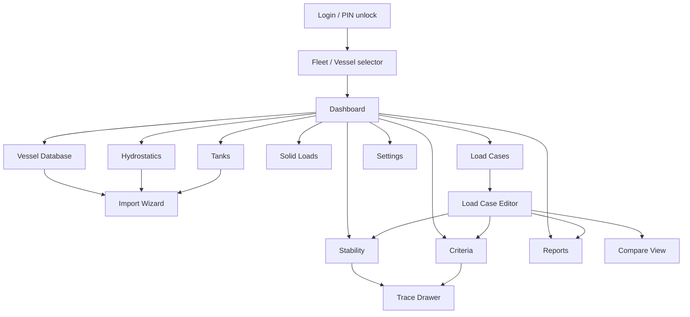
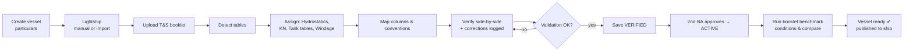
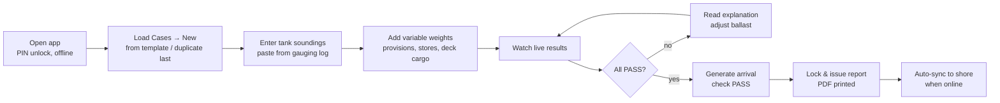

# UI/UX Specification

**StabilitySoft — Vessel Stability Platform**

| Item | Value |
|---|---|
| Document ID | SS-UX-001 |
| Version | 0.1 (Draft) |
| Owner | UI/UX Lead |
| Related | SS-PRD-001, SS-SRS-001 |

---

## 1. Design philosophy

**"Bridge-grade clarity."** The interface should feel like premium marine engineering software, in the tradition of NAPA, Maxsurf and Kongsberg K-Chief: dense, precise and calm. It should never feel like a consumer web app.

| Principle | Meaning in practice |
|---|---|
| Information density with hierarchy | Many numbers on screen, but a clear primary figure per panel (e.g. GM_fluid large, details small) |
| Status is unmistakable | PASS/FAIL uses colour **plus** icon **plus** text. Never colour alone |
| Every number explains itself | Hover = unit and source. Click = trace panel (formula, inputs, dataset version) |
| Calm by default, loud only on danger | Neutral palette. Red is reserved for failures and blocking errors |
| Keyboard first for data entry | Spreadsheet-like grids: arrow keys, Enter, Tab, paste ranges |
| Night-bridge safe | Dark theme and a red-tinted "Night" mode that preserves night vision |
| Offline is normal | Offline state is shown calmly, not as an error |

---

## 2. Visual design system

### 2.1 Colour tokens

| Token | Light | Dark | Use |
|---|---|---|---|
| `--bg` | #F4F6F8 | #0B1218 | App background |
| `--surface` | #FFFFFF | #111B24 | Panels |
| `--surface-2` | #EEF1F4 | #172430 | Grid headers, inset areas |
| `--border` | #D5DBE1 | #243443 | Dividers |
| `--text` | #0F1A24 | #E3EAF0 | Primary text |
| `--text-muted` | #5A6B7A | #8DA0B1 | Labels, units |
| `--accent` (Ocean) | #0A5C8F | #3BA3E0 | Primary actions, selection, GZ curve |
| `--pass` | #1E7D4F | #3FC285 | PASS |
| `--warn` | #A86200 | #F2A93B | Warnings |
| `--fail` | #B3261E | #FF6B5E | FAIL / blocking errors |
| `--info` | #4B5FA8 | #8C9EF0 | Informational, AI-extracted marks |
| `--ballast` / `--fuel` / `--fw` / `--cargo` | #2E86C1 / #7D4E24 / #48C9B0 / #8E7CC3 | lighter variants | Tank group colours |

The Night mode applies a red-on-black palette at ≤ 20% luminance, with charts in red/amber only.

### 2.2 Typography
- UI: **Inter** (variable). Numbers: **tabular figures** (`font-variant-numeric: tabular-nums`) so columns align.
- Engineering values: **JetBrains Mono** or Inter tabular in grids.
- Scale: 12 / 13 (grid default) / 14 (body) / 16 / 20 / 28 (KPI) / 40 (hero KPI).

### 2.3 Spacing, density, shape
- 4 px base grid. Two density modes: **Comfortable** (office) and **Compact** (grids, default 28 px row height).
- Radius 6 px (panels), 4 px (inputs). Elevation via borders, not heavy shadows.

### 2.4 Components (design system `packages/ui`)
App shell, Left nav, Top bar, Status bar, Panel (dockable), Tabs, Data grid (virtualised, editable, unit-aware), Numeric input with unit and range, Input-mode selector (Filled / % / m³ / t / Sounding), Status badge (PASS/FAIL/WARN with icon), Dataset badge (DRAFT / VERIFIED / ACTIVE + source IMPORTED/MANUAL), Trace drawer, KPI tile, Charts (GZ, hydrostatic curves, weight distribution, tank plan, draft/trim profile), Compare table, Import split-view, Toasts, Command palette (Ctrl+K), Confirm dialog with reason field.

### 2.5 Charts — engineering style rules
- White/dark background with a light grid. Axis titles with units. Ticks at engineering intervals (10° heel; 0.1 m GZ).
- No 3D, gradients or animations on data (except a 150 ms transition on recalc).
- Every chart is printable in monochrome: line styles (solid/dashed/dotted) and markers, not only colours.
- Crosshair readout on hover. Export as PNG/SVG.

---

## 3. Application layout

```
┌──────────────────────────────────────────────────────────────────────────────────────────┐
│ ⚓ StabilitySoft │ MV OCEAN PIONEER ▾ (IMO 9412345) │ Load case: Departure Rotterdam ▾ │ 🔍 Ctrl+K │ ☾ │ 👤 │
├──────────────┬───────────────────────────────────────────────────────────────────────────┤
│  ▣ Dashboard │                                                                           │
│  ⛴ Vessel DB │                                                                           │
│  〰 Hydrostat.│                     MAIN WORKSPACE                                        │
│  ▤ Tanks     │      (module content: tabs, grids, charts, dockable panels)               │
│  ▦ Solid Lds │                                                                           │
│  ☰ Load Cases│                                                    ┌──────────────────┐   │
│  ∠ Stability │                                                    │ RESULTS SIDEBAR  │   │
│  ✓ Criteria  │                                                    │ (collapsible)    │   │
│  ⎙ Reports   │                                                    │ Δ, drafts, GM,   │   │
│  ─────────── │                                                    │ criteria status  │   │
│  ⇪ Import    │                                                    └──────────────────┘   │
│  ⚙ Settings  │                                                                           │
├──────────────┴───────────────────────────────────────────────────────────────────────────┤
│ ● Offline · 3 changes pending · Last sync 14:02 UTC │ Data: ACTIVE v4 ✔ │ Engine 1.0.0 │ ⚠ Not class-approved │
└──────────────────────────────────────────────────────────────────────────────────────────┘
```

- **Top bar:** vessel switcher, load-case switcher, global search/command palette, theme toggle, user menu.
- **Left navigation:** collapsible to an icon rail. Badges show counts or warnings (e.g. "Tanks ⚠ 2").
- **Results sidebar:** visible on every load-case-related screen. It shows live results while editing.
- **Status bar:** connectivity, sync, data state, engine version, approval disclaimer.

---

## 4. Screen specifications & wireframes

### 4.1 Dashboard

**Purpose:** at-a-glance vessel and condition status.

```
┌─ Dashboard ─────────────────────────────────────────────────────────────────────────────┐
│ ┌─ Vessel ───────────────────────┐ ┌─ Active Load Case ──────────────────────────────┐ │
│ │ MV OCEAN PIONEER                │ │ Departure Rotterdam · Rev 2 · 03 Nov 2026       │ │
│ │ IMO 9412345 · Call sign 9V1234 │ │                                                  │ │
│ │ Product tanker · LBP 176.00 m  │ │  ┌──────────┐ ┌──────────┐ ┌──────────┐          │ │
│ │ B 32.20 m · D 18.80 m          │ │  │ Δ        │ │ GM fluid │ │ Trim     │          │ │
│ │ Data status: ACTIVE ✔ (v4)     │ │  │ 18 452 t │ │ 1.227 m  │ │ 0.62 m A │          │ │
│ └────────────────────────────────┘ │  └──────────┘ └──────────┘ └──────────┘          │ │
│                                    │  Drafts  AP 7.612  MS 7.300  FP 6.988  Heel 0.2°S │ │
│ ┌─ Compliance ───────────────────┐ └──────────────────────────────────────────────────┘ │
│ │  ✔ PASS  IS Code 2008 General   │ ┌─ GZ Curve (mini) ───────────────────────────────┐ │
│ │  ✔ PASS  Weather Criterion      │ │   GZ                                            │ │
│ │  ⚠ 1 operational warning        │ │   ▲      ╭──╮                                   │ │
│ │  Lowest margin: Area 30–40°     │ │   │   ╭─╯    ╰─╮                                │ │
│ │  +18.3 %                        │ │   │ ╭╯          ╰╮                              │ │
│ └────────────────────────────────┘ │   └┴──────────────┴──▶ heel°                    │ │
│                                    └──────────────────────────────────────────────────┘ │
│ ┌─ Recent load cases ─────────────────────────────────────────────────────────────────┐ │
│ │ Name                    Type       Δ (t)    GM (m)  Status   Updated      Sync     │ │
│ │ Departure Rotterdam     Departure  18 452   1.227   ✔ PASS   10:41        ✔        │ │
│ │ Arrival Houston         Arrival    17 210   1.104   ✔ PASS   10:55        ⟳        │ │
│ │ Ballast Heavy Weather   Ballast     9 870   3.412   ✖ FAIL   Yesterday    ✔        │ │
│ └─────────────────────────────────────────────────────────────────────────────────────┘ │
└─────────────────────────────────────────────────────────────────────────────────────────┘
```

For shore users with fleet access, a **Fleet view** variant shows one card or row per vessel with its latest condition status.

### 4.2 Vessel Database

Tabs: **General Particulars · Lightship · Fixed Weights · Windage · Openings & Angles · Operational Limits · Data Versions**

```
┌─ Vessel Database › General Particulars ────────────── Dataset: PARTICULARS v3 [ACTIVE ✔] [MANUAL] ─┐
│ Identification                     Main dimensions                    Hydrostatic reference        │
│ Ship name   [MV OCEAN PIONEER   ]  LOA         [183.00] m             Ref. density [1.025] t/m³    │
│ IMO number  [9412345] ✔ check-dig  LBP         [176.00] m             Long. origin  (•) AP ( ) MS   │
│ Call sign   [9V1234 ]              Breadth mld [ 32.20] m             Long. +dir    (•) Fwd ( ) Aft │
│ Flag        [Singapore ▾]          Depth mld   [ 18.80] m             Keel thick.  [0.018] m       │
│ Ship type   [Product tanker ▾]     Design drft [ 11.00] m             Bilge type   (•) Round ( ) Sharp│
│                                                                       Bilge keel A_k [ 42.6] m²     │
│ Draft limits (Load Line)                                                                           │
│ Zone      Summer  Winter  Tropical  Fresh  Trop.Fresh                                              │
│ Draft m   11.02   10.79   11.25     11.27  11.50                                                   │
│                                                                                                    │
│ [Cancel]                                      [Save as new version (Draft)]  [Verify →]           │
└────────────────────────────────────────────────────────────────────────────────────────────────────┘
```

**Data Versions tab:** a timeline of all dataset versions per type, with status, source mode, source file, verifier/approver, and actions (View, Compare, Approve, Archive).

### 4.3 Hydrostatics

Sub-tabs: **Hydrostatic Table · KN Cross Curves · Graphs**

```
┌─ Hydrostatics › Table ─────── HYDROSTATICS v2 [ACTIVE ✔] [IMPORTED from T&S Booklet p.34–41] [🔒] ─┐
│ Source mode: IMPORTED — direct editing disabled. Corrections only via Import Verification.         │
│ ρ_ref 1.025 t/m³ · Trim 0.00 m · 112 rows · Validation ✔ 0 errors · 1 warning (row 3: KM≠KB+BM 2mm)│
│ ┌──────┬────────┬────────┬───────┬────────┬────────┬────────┬───────┬───────┬───────┬────────┐   │
│ │Draft │ Δ (t)  │ ∇ (m³) │TPC t/cm│MTC tm/cm│LCB m  │ LCF m  │ KB m  │ BM m  │ KM m  │ Awp m² │   │
│ ├──────┼────────┼────────┼───────┼────────┼────────┼────────┼───────┼───────┼───────┼────────┤   │
│ │ 2.000│  9 512 │  9 280 │ 42.10 │  198.4 │ 90.512 │ 89.840 │ 1.041 │ 41.20 │ 42.24 │ 4 107  │   │
│ │ 2.100│  9 934 │  9 692 │ 42.18 │  199.1 │ 90.498 │ 89.801 │ 1.093 │ 39.31 │ 40.40 │ 4 115  │   │
│ │  …   │   …    │   …    │  …    │   …    │   …    │   …    │  …    │  …    │  …    │  …     │   │
│ └──────┴────────┴────────┴───────┴────────┴────────┴────────┴───────┴───────┴───────┴────────┘   │
│ [Export CSV] [Create new version…]                                          [View source PDF ↗]  │
└────────────────────────────────────────────────────────────────────────────────────────────────────┘
```

**KN Cross Curves:** a matrix grid (rows = displacement, columns = heel angles) next to a "family of curves" chart (KN vs displacement, one line per angle) for visual sanity checking. Discontinuities are highlighted.

**Graphs:** multi-axis hydrostatic curves (Δ, KM, KB, LCB, LCF, TPC, MTC vs draft). The user toggles curves. The current load case's draft is shown as a vertical marker.

### 4.4 Tanks

Two panes: **tank list** (left) and **tank detail** (right: Master data · Calibration table · Diagram).

```
┌─ Tanks ──────────────────────────────────────────────────────────────────────────────────────────┐
│ Filter [All groups ▾] [🔍      ]       │  No.2 WB Tank (P) — Ballast · Port · Fr 45–62             │
│ ┌──────────────────┬──────┬─────────┐  │  Capacity 100%: 1 284.6 m³ · Density 1.025 · Consumable ☐ │
│ │ Tank             │Group │Cal. data│  │  FSM group: WB-2 · FSM exempt ☐                           │
│ │ FPT              │ WB   │ ✔ v1   │  │  Calibration: v1 [ACTIVE ✔] [IMPORTED p.88]              │
│ │ No.1 WB (P)      │ WB   │ ✔ v1   │  │ ┌────────┬────────┬───────┬───────┬───────┬──────────┐    │
│ │ No.1 WB (S)      │ WB   │ ✔ v1   │  │ │Snd (m) │Vol (m³)│LCG m  │TCG m  │VCG m  │ i_T (m⁴) │    │
│▶│ No.2 WB (P)      │ WB   │ ✔ v1   │  │ │ 0.10   │   12.4 │ 98.21 │ −6.12 │ 0.06  │   410    │    │
│ │ No.2 WB (S)      │ WB   │ ⚠ DRAFT│  │ │ 0.20   │   31.7 │ 98.30 │ −7.45 │ 0.12  │  2 980   │    │
│ │ HFO 1 (P)        │ FO   │ ✔ v2   │  │ │  …     │   …    │  …    │  …    │  …    │   …      │    │
│ │ …                │      │         │  │ └────────┴────────┴───────┴───────┴───────┴──────────┘    │
│ └──────────────────┴──────┴─────────┘  │  ┌ Tank diagram (profile + plan, this tank highlighted) ┐  │
│ [+ Add tank] [Import tanks…]           │  └──────────────────────────────────────────────────────┘  │
└──────────────────────────────────────────────────────────────────────────────────────────────────┘
```

### 4.5 Solid Loads

A grid of **Fixed weights** (vessel master data, versioned) and a **Weight library** (templates). Variable weights are edited within a load case (§4.6). Columns: Description · Category · Weight t · LCG · TCG · VCG · Wind area m² · Wind centroid m · Notes.

### 4.6 Load Cases (core working screen)

**List view:** a table of load cases with filters (Type, Status, Archived), multi-select actions **Duplicate · Compare · Export · Archive**.

**Editor view:** a three-zone layout.

```
┌─ Load Case: Departure Rotterdam · Rev 2 · [Editable] ────────────── [Duplicate] [Compare] [Lock & Report] ┐
│ Type [Departure ▾]  Date [03-Nov-2026]  SW density [1.025]  Zone [Summer ▾]  FSM [IS Code ▾]  Criteria [IS2008 Gen ✔][Weather ✔] │
├──────────────────────────────────────────────────────────────────────────────┬────────────────────────────┤
│ [Tanks] [Variable weights] [Summary] [Tank plan]                              │ RESULTS (live)             │
│ ┌───────────────┬──────────┬──────────┬───────┬────────┬────────┬───────┬───┐│ Δ          18 452.3 t      │
│ │ Tank          │ Input    │ Value    │ %     │ m³     │ t      │ FSM   │ ⚠ ││ DWT        12 210.8 t      │
│ ├───────────────┼──────────┼──────────┼───────┼────────┼────────┼───────┼───┤│ Draft AP     7.612 m       │
│ │ FPT           │ Sounding▾│ 6.420 m  │ 99.1 %│  612.0 │  627.3 │   0   │ ⚠ ││ Draft FP     6.988 m       │
│ │ No.1 WB (P)   │ % ▾      │ 100 %    │ 100.0%│  842.1 │  863.2 │   0   │   ││ Trim         0.624 m A     │
│ │ No.2 WB (P)   │ m³ ▾     │ 640.0    │  49.8%│  640.0 │  656.0 │ 3 120 │   ││ Heel         0.2° S        │
│ │ HFO 1 (P)     │ t ▾      │ 820.0 t  │  84.4%│  836.7 │  820.0 │ 1 410 │   ││ KG fluid     7.987 m       │
│ │ FW (S)        │ Filled ▾ │ Full     │ 100.0%│  210.0 │  210.0 │   0   │   ││ GM fluid     1.227 m  ✔    │
│ │ …             │          │          │       │        │        │       │   ││ ────────────────────────── │
│ └───────────────┴──────────┴──────────┴───────┴────────┴────────┴───────┴───┘│ IS 2008 General  ✔ PASS    │
│ Σ Tanks 6 241.7 t · Σ FSM 9 842 t·m · ⚠ FPT 99.1 % > 98 %                      │ Weather          ✔ PASS    │
│                                                                                │ Operational      ⚠ 1      │
│                                                                                │ [Open Stability →]         │
├──────────────────────────────────────────────────────────────────────────────┴────────────────────────────┤
│ Weight summary:  Lightship 6 241.5 · Fixed 0.0 · Tanks 6 241.7 · Variable 5 969.1 · Total 18 452.3 t     │
└──────────────────────────────────────────────────────────────────────────────────────────────────────────┘
```

Interaction details:
- **Input mode selector** per tank row (Filled / % / m³ / t / Sounding / Ullage). Changing mode keeps the physical quantity: the value converts and displays in the new mode.
- All derived columns are read-only and recompute instantly.
- Row warnings (⚠) show tooltips. Blocking errors (✖) disable "Lock & Report".
- **Paste a column of soundings** from the gauging log or Excel. The paste is validated row by row.
- **Arrival generator** (from the toolbar ⋯ menu): a dialog with consumption % per tank group, which previews a new load case.

**Compare view:** up to 4 columns, one per load case. Rows hold key results and criteria (margins). Differences beyond a threshold are highlighted. Below sits an overlaid GZ chart and a tank delta table.

### 4.7 Stability

Tabs: **GZ Curve · GZ Table · Hydrostatics at Condition · Weight Distribution · Weather Criterion · Trace**

```
┌─ Stability › GZ Curve ───────────────────────── Range [0]° to [90]° step [1]° ─ [Overlay ▾] [Export ▾] ┐
│  GZ (m)                                                                                             │
│  1.4 ┤                          ● GZmax 1.312 m @ 38.0°                                              │
│  1.2 ┤                     ╭────────╮                                                                │
│  1.0 ┤                ╭───╯          ╰──╮                                                            │
│  0.8 ┤            ╭──╯                   ╰─╮          ┊θf 42.6°                                       │
│  0.6 ┤        ╭──╯   GM tangent ⟋          ╰╮        ┊                                               │
│  0.4 ┤     ╭─╯     ⟋                         ╰╮      ┊                                               │
│  0.2 ┤═══╭╯═══⟋═══════════════════════════════╰═════┊══ l_w2 0.063 m                                 │
│  0.0 ┼──┴──┬────┬────┬────┬────┬────┬────┬────┬────┬────┬──▶ Heel (°)                               │
│      0    10   20   30   40   50   60   70   80   90                                                │
│  Legend: ── GZ  ⟋ GM (at 57.3°)  ═ wind levers  ┊ flooding angle  ░ areas a/b (Weather tab)         │
├─────────────────────────────────────────────────────────────────────────────────────────────────────┤
│ GM fluid 1.227 m · GZmax 1.312 m @ 38.0° · AVS 78.4° · Range 78.2° · Area 0–30 0.2140 · 0–40 0.3752 m·rad │
└─────────────────────────────────────────────────────────────────────────────────────────────────────┘
```

**GZ Table** (real-time):

| Heel (°) | KN (m) | KG_fluid·sin φ (m) | TCG·cos φ (m) | GZ (m) |
|---|---|---|---|---|
| 0 | 0.000 | 0.000 | 0.012 | −0.012 |
| 10 | 1.612 | 1.387 | 0.012 | 0.213 |
| … | … | … | … | … |

**Weather Criterion tab:** a chart with GZ, l_w1 and l_w2, the roll-back angle θ₀ − θ₁, the shaded areas a (red hatched) and b (green hatched), θ₂, plus a parameter table (P, A, Z, Δ, l_w1, l_w2, B/d, C_B, X₁, X₂, k, r, s, T, θ₀, θ₁, θ₂, area a, area b, b/a).

**Weight Distribution:** a ship-profile silhouette with weight bars along the length (lightship distribution approximated if no curve is provided, plus tanks and weights at their LCG) and markers for LCG, LCB and LCF.

**Trace:** a searchable tree of every computed value, showing formula → inputs (clickable) → sources (dataset + version + row).

### 4.8 Criteria

```
┌─ Criteria ─ Sets applied: [✔ IS Code 2008 — General §2.2 (v1, statutory)] [✔ Weather §2.3 (v1)] [+ Add set] ┐
│ Overall: ✔ PASS (8/8)                                                                                     │
│ ┌──────────────┬──────────────────────────────────┬──────────┬──────────┬──────────┬──────────┬────────┐ │
│ │ Ref          │ Criterion                        │ Required │ Actual   │ Margin   │ Margin % │ Status │ │
│ ├──────────────┼──────────────────────────────────┼──────────┼──────────┼──────────┼──────────┼────────┤ │
│ │ 2.2.1 (a)    │ Area 0–30°                        │ ≥0.0550  │ 0.2140   │ +0.1590  │ +289.1%  │ ✔ PASS │ │
│ │ 2.2.1 (b)    │ Area 0–40° or θf                  │ ≥0.0900  │ 0.3752   │ +0.2852  │ +316.9%  │ ✔ PASS │ │
│ │ 2.2.1 (c)    │ Area 30–40° or θf                 │ ≥0.0300  │ 0.1612   │ +0.1312  │ +437.3%  │ ✔ PASS │ │
│ │ 2.2.2        │ GZ at ≥ 30°                       │ ≥0.200 m │ 1.312 m  │ +1.112   │ +556.0%  │ ✔ PASS │ │
│ │ 2.2.3        │ Angle of max GZ                   │ ≥25.0°   │ 38.0°    │ +13.0°   │ +52.0%   │ ✔ PASS │ │
│ │ 2.2.4        │ Initial GM₀                       │ ≥0.150 m │ 1.227 m  │ +1.077   │ +718.0%  │ ✔ PASS │ │
│ │ 2.3 (heel)   │ θ₀ ≤ min(16°, 0.8·θ_deck)         │ ≤16.0°   │ 2.1°     │ +13.9°   │ +86.9%   │ ✔ PASS │ │
│ │ 2.3 (area)   │ Area b ≥ Area a                   │ b ≥ a    │ b/a 3.76 │ +0.0334  │ +276.0%  │ ✔ PASS │ │
│ └──────────────┴──────────────────────────────────┴──────────┴──────────┴──────────┴──────────┴────────┘ │
│ ▸ Click a row: explanation, formula, graph highlight, sensitivity ("GM ↑0.10 m per 100 t ballast in DB 2")│
│ Operational limits: ⚠ FPT above 98 % ; ✔ Draft ≤ Summer ; ✔ Trim ≤ 2.0 m                                │
└───────────────────────────────────────────────────────────────────────────────────────────────────────────┘
```

When a criterion fails, the row expands automatically with the explanation (Appendix A §A.10) and the top three suggested levers. These are suggestions only. The system never changes the load case on its own.

### 4.9 Reports

- Template selector (Full condition report / Summary / Compare report).
- Section toggles (all on by default; the criteria and trace sections cannot be removed from an official report).
- Live PDF preview pane.
- Buttons: **Preview · Export PDF · Export Excel · Issue (lock + store)**.
- Issued-reports list with run hash and verification QR.

### 4.10 Import (wizard)

```
 ① Upload  ──  ② Detect tables  ──  ③ Assign & map  ──  ④ Verify  ──  ⑤ Save & approve
```

**Step ④ Verify (split view):**

```
┌─ Import › Verify: "Hydrostatic Table" from T&S_Booklet.pdf (p.34) ───────────── 112 rows · 6 low-confidence ┐
│ ┌─ Source page ─────────────────────────────┐ ┌─ Extracted data (editable) ──────────────────────────────┐ │
│ │ [PDF page image, zoomable]                │ │ Draft │ Δ      │ TPC   │ MTC   │ LCB    │ KM     │       │ │
│ │   ┌──────────────────────────┐            │ │ 2.000 │ 9 512  │ 42.10 │ 198.4 │ 90.512 │ 42.24  │       │ │
│ │   │ ▓▓ highlighted source cell│◀──────────┼─│ 2.100 │ 9 934  │ 42.18 │ 199.1 │ 90.498 │ [4O.40]│◀ ⚠ OCR │ │
│ │   └──────────────────────────┘            │ │  …                                                       │ │
│ │ Page ◀ 34/212 ▶   Zoom [125%]             │ │ Validation: ✖ 1 error (row 2 KM non-numeric) · ⚠ 2 warn  │ │
│ └───────────────────────────────────────────┘ └──────────────────────────────────────────────────────────┘ │
│ Column mapping: Draft→draft (m) · Δ→displacement (t) · LCB→lcb (m, from AP, +fwd) …   [Edit mapping]     │
│ Corrections made: 3 (each logged with reason)                                                            │
│ ☐ I have verified all values against the source document.                       [Back] [Save as VERIFIED]│
└──────────────────────────────────────────────────────────────────────────────────────────────────────────┘
```

- Low-confidence cells have an amber outline and must be confirmed (press Enter on the cell or "Confirm row").
- Editing a cell asks for a short reason (pre-filled options: "OCR misread", "Table typo in source", "Unit conversion"). The reason is logged.
- AI-extracted values carry an "AI" chip until confirmed.
- **Save** is disabled until there are 0 errors, all low-confidence cells are confirmed and the attestation is ticked.

### 4.11 Settings

Sections: **Organisation** (branding, four-eyes rule, offline grace period) · **Users & Roles** · **Units & Display** (decimal places, date format) · **Calculation defaults** (FSM method, interpolation, GZ range, warning thresholds) · **Criteria sets** · **Import** (AI extraction on/off, confidence threshold, mapping templates) · **Offline & Sync** (downloaded vessels, storage use, force sync) · **Appearance** (Light / Dark / Night / System, density) · **About** (engine version, approval status, licences).

---

## 5. Navigation flows

### 5.1 Site map



### 5.2 Flow: build a new vessel database (Naval Architect)



### 5.3 Flow: departure condition onboard (Chief Officer)



---

## 6. User journeys

### 6.1 Journey: Chief Officer, pre-departure at night, offline

| Stage | Action | Thoughts / feelings | Design response |
|---|---|---|---|
| Open | Launches app on the ship-office PC, enters PIN | "Hope it works without internet" | Fast offline start. Calm "Offline: all functions available" pill |
| Start | Duplicates last voyage's departure | "Most is the same" | Duplicate keeps tank modes; date auto-updated |
| Enter | Pastes 32 soundings from the gauging log | "Don't want to type all this" | Paste column with per-row validation; 1 warning (FPT 99%) |
| Review | Sees GM 1.23 m, all PASS | "Good margins" | KPI tiles + criteria margins |
| What-if | Reduces FPT to 95% | "Quick check" | Recalculation in < 0.2 s, margin changes highlighted |
| Arrival | Generates arrival with 90% consumables used | "Easy" | Arrival generator preview |
| Issue | Locks and prints report | "Ready for the Master's signature" | Report with signature blocks |
| Later | Ship regains connectivity, sync happens | "Office can see it" | Status bar shows "Synced ✔" |

### 6.2 Journey: Naval Architect onboarding a new vessel

| Stage | Action | Pain today | Design response |
|---|---|---|---|
| Collect | Gets T&S booklet PDF (212 pp) | Retyping 3,000 values | Import wizard detects ~40 tables |
| Map | Assigns tables, reuses yard template | Different formats per yard | Mapping templates per yard |
| Verify | Checks side by side, fixes 6 OCR misreads | Errors invisible in Excel | Source highlight + low-confidence focus |
| Validate | KM ≠ KB + BM on one row | Never checked before | Automatic engineering checks |
| Approve | Colleague approves | No formal process | Four-eyes workflow, audit log |
| Benchmark | Recomputes the 12 booklet conditions | Manual comparison | Benchmark report: deltas vs booklet, all within tolerance |

---

## 7. Accessibility & usability requirements

- WCAG 2.2 AA: contrast ≥ 4.5:1 for text, full keyboard navigation, visible focus, ARIA on grids and charts (data tables provided as alternatives for charts).
- Minimum click target 24×24 px (32 px in toolbars).
- No time-limited interactions.
- Error messages state the problem, the location and the fix: *"Sounding 7.200 m exceeds table maximum 6.950 m for FPT."*
- Undo/redo (Ctrl+Z / Ctrl+Y) in the load case editor.
- Usability testing with deck officers each phase. Target SUS ≥ 80.

## 8. Responsive behaviour

| Width | Layout |
|---|---|
| ≥ 1600 px | Nav + workspace + results sidebar always visible |
| 1280–1599 | Nav collapsible to rail. Results sidebar collapsible |
| 1024–1279 (tablet, S) | Nav as rail. Results sidebar as bottom sheet |
| < 1024 | Read-only summary views (Phase 4 mobile app for full use) |

## 9. Print design
Reports use dedicated print templates (not a screen capture): A4 portrait with landscape inserts for wide tables. They have header/footer, page X of Y, run hash, and a disclaimer until approved. Charts are rendered as vectors.
