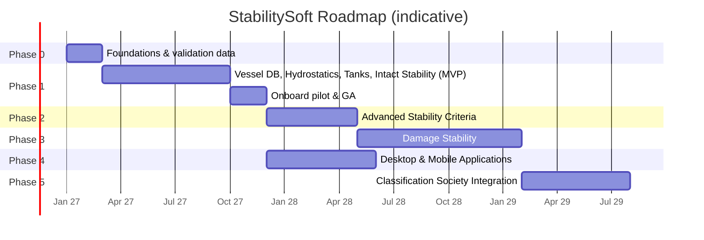

# Development Roadmap

**StabilitySoft — Vessel Stability Platform**

| Item | Value |
|---|---|
| Document ID | SS-ROAD-001 |
| Version | 0.1 (Draft) |
| Owner | Product Manager / Technical Lead |

> Durations assume the core team below and 2-week sprints. They are planning estimates to be refined at each phase gate.

## Team (Phase 1)

| Role | FTE |
|---|---|
| Product Manager | 1 |
| Technical Lead / Architect | 1 |
| Senior Naval Architect (domain owner, validation sign-off) | 1 |
| Calculation engine engineers (TS) | 2 |
| Frontend engineers (React/Next.js) | 2 |
| Backend engineer (NestJS/PostgreSQL) | 1 |
| Python engineer (file processing) | 1 |
| UI/UX designer | 1 |
| QA / Test automation engineer | 1 |
| DevOps (shared) | 0.5 |

---

## Overview

Phase 4 (desktop/mobile packaging) can run in parallel with Phases 2–3 because the architecture separates platform shells from the UI and engine.

---

## Phase 0: Foundations (≈ 2 months)

| Workstream | Deliverables |
|---|---|
| Engineering reference | Appendix A reviewed and signed by the Senior Naval Architect. Choose 3 benchmark vessels with approved T&S booklets |
| Benchmark data | Booklet data manually transcribed **twice independently** and reconciled into a "golden dataset" with all booklet loading conditions as expected results |
| Platform | Monorepo, CI/CD, environments, IaC, coding standards, design tokens |
| Design | Design system v1, high-fidelity prototypes of Load Case Editor, Stability and Import Verify. Usability test with 5 officers |
| Engine spike | Interpolation, GZ and IS 2.2 criteria proven against one benchmark vessel |

**Gate G0:** Appendix A approved. Prototype usability test SUS ≥ 70. Engine spike matches benchmark vessel 1 within tolerance.

---

## Phase 1: Vessel Database, Hydrostatics, Tanks, Intact Stability (≈ 7 + 2 months)

### Milestones

| # | Milestone | Sprints | Content |
|---|---|---|---|
| M1.1 | **Core platform** | 1–3 | Auth (OIDC + offline PIN), RBAC, org/vessel model, dataset versioning & state machine, audit log, app shell (nav, themes, status bar), PWA shell & Service Worker |
| M1.2 | **Vessel database** | 3–5 | Particulars, lightship, fixed weights, windage, openings, operational limits; manual-entry grids with validation; Data Versions screen |
| M1.3 | **Hydrostatics & KN** | 4–6 | Tables, trimmed tables, KN matrix, validation rules, graphs |
| M1.4 | **Tanks** | 5–7 | Tank master, calibration tables, all input modes, FSM, tank plan diagram |
| M1.5 | **Import module** | 5–9 | xlsx/csv (client), PDF/DOCX (server), table detection, mapping templates, split-view verification, logged corrections, attestation, approval; AI-assist (feature flag) |
| M1.6 | **Calculation engine v1.0** | 2–10 | Full Appendix A: summation, hydrostatics, trim/drafts, FSC methods, GZ, flooding angle, wind levers, IS 2.2, Weather 2.3, explanations, trace; dual implementation & CI benchmark suite |
| M1.7 | **Load cases** | 7–10 | Editor, live results, duplicate, compare, archive, lock/revise, arrival generator, templates |
| M1.8 | **Stability & criteria UI** | 8–11 | GZ chart/table, Weather chart, criteria table, trace drawer, weight distribution, dashboard |
| M1.9 | **Reports** | 10–12 | PDF/Excel, issue & lock, run hash/QR verification |
| M1.10 | **Offline & sync** | 6–12 | Local DB replica, outbox, conflicts UI, background sync, bootstrap download |
| M1.11 | **Hardening** | 12–14 | Performance, security pen-test, accessibility audit, documentation, data-preparation guide |
| M1.12 | **Pilot** | +2 mo | 2 vessels onboard, ≥ 1 offline voyage, feedback fixes |

### Phase 1 exit criteria (Gate G1 / GA)
- All SRS "M" requirements verified.
- 3 benchmark vessels: all booklet conditions within Appendix A §A.13 tolerances.
- Usability: ≥ 90% task success. SUS ≥ 80.
- Pen-test: no open High or Critical findings.
- Pilot: no data loss, no unresolved sync conflicts, officers prefer the system over Excel.

---

## Phase 2: Advanced Stability Criteria (≈ 5 months)

| Feature | Notes |
|---|---|
| User-defined criteria composer | Build criteria from primitives (area between angles, GZ at angle, angle of max GZ, GM, heel under moment, ratio of areas). Non-statutory label |
| Additional heeling moments | Providers: **Turning**, **Passenger crowding**, **Ice accretion** (weight + windage modifier), **Crane** (lifted load at boom tip), **Towing**, **Dynamic wind**, **Custom table l(φ)** |
| Ship-type criteria sets | Passenger ships (IS 2008 Part A §3.1), offshore supply vessels, cargo ships carrying timber deck cargo, special-purpose ships (as data-driven sets where the methods permit) |
| Grain stability | Grain heeling moments per hold, Grain Code criteria (heel ≤ 12°, residual area, etc.) |
| Free-trim KN & hydrostatics | Full free-trim GZ when free-trim cross curves are available |
| Longitudinal strength (S) | Shear force & bending moment vs permissible values (requires lightship weight distribution & buoyancy curve data) |
| Fleet dashboard & analytics | Compliance trends, lowest margins, data-currency alerts |

**Gate G2:** each new criteria set is validated against reference cases signed by the Senior Naval Architect.

---

## Phase 3: Damage Stability (≈ 9 months)

| Feature | Notes |
|---|---|
| 3D hull & compartment model | Import hull offsets / IGES / NAPA/Maxsurf exports. Compartment definitions. Permeabilities |
| Direct hydrostatics | Hydrostatics, KN and tank calibration computed from geometry (also improves intact accuracy at large trim/heel) |
| Deterministic damage | Damage cases (lost buoyancy & added weight), progressive flooding through openings, equilibrium solver with free trim & heel |
| Damage criteria | SOLAS Ch. II-1 deterministic (where applicable), MARPOL Annex I Reg. 28, IBC/IGC damage criteria |
| Probabilistic (S) | SOLAS 2009 probabilistic attained index A (later sub-phase) |
| Hull-based flooding angle | Replaces the approximate method in Appendix A §A.7.3 |

**Gate G3:** results validated against approved damage stability calculations for ≥ 2 vessels.

---

## Phase 4: Mobile & Desktop Applications (≈ 6 months, parallel)

| Platform | Approach | Added value |
|---|---|---|
| **Desktop** (Windows, macOS, Linux) | **Tauri 2** shell around the same web build; embedded SQLite replica via adapter | Unlimited local storage, file-system access, native printing, tank-gauging integrations (OPC-UA/Modbus/NMEA), auto-update, runs on isolated ship networks |
| **Mobile/Tablet** (iPadOS, Android) | **Capacitor** shell; responsive tablet layout | Surveyor and superintendent use, onboard rounds (sounding entry on tablet), offline |
| Shared | Platform adapter interfaces (storage, files, print, auth, notifications) defined in Phase 1 | No rewrite of UI or engine |

**Gate G4:** feature parity tests pass on all platforms. Engine output is bit-identical across platforms.

---

## Phase 5: Classification Society Integration (≈ 6 months)

| Feature | Notes |
|---|---|
| Type approval | Prepare & submit to class per **IACS UR L5** and **IMO MSC.1/Circ.1229** (stability instrument approval: test conditions, accuracy, documentation, version control) |
| Vessel-specific approval | Installation test package: approved test conditions per vessel, auto-generated comparison report for the surveyor |
| Approved-mode lock | Once approved, vessel data and engine version are locked to the approved configuration. Any change triggers a re-approval workflow. The disclaimer is removed only for approved vessel + version combinations |
| Class data exchange | Export submission packages (data, test conditions, results). APIs/portals of class societies where available |
| Audit portal | Read-only portal for surveyors / PSC with run-hash verification |
| Periodic checks | Scheduled self-check: re-run approved test conditions on each start/update and on demand; report deviations |

**Gate G5:** type approval certificate from at least one IACS member society.

---

## Cross-phase practices

- **Definition of Done** for any calculation feature: Appendix A updated → reference implementation updated → tests with hand-checked values → benchmark suite green → Naval Architect sign-off.
- **Release cadence:** client & API every 2 weeks (feature flags). Engine releases only with a validation report.
- **Data migrations:** versioned Prisma migrations. Never destructive to engineering data. Backward-compatible API for at least 2 client versions, because ships may update late.
- **Risk reviews** at each gate (see PRD §7).
